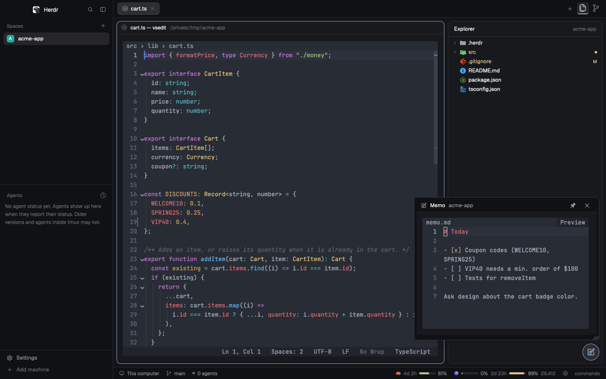

# herdr-layout-code

A VS Code-style layout for [Herdr](https://herdr.dev): a file explorer, a terminal code editor, source control and a viewer, in Herdr's own panes and tabs.

[RECIPE.md](RECIPE.md) is the detailed spec: exactly what each part does and how it is built.

## Features

### Explorer
- Material Icon Theme icons and VS Code git colors, including repos nested in the folder.
- VS Code's right-click menu (new, open with, reveal, cut/copy/paste, copy path, rename, delete to Trash), and keyboard shortcuts in the tree.
- Drag and drop: move or copy items between folders, drop files from Finder into the folder under the pointer (uploaded when the space is remote), drag a file onto a pane to open it as a split.
- Reveal the active file; deleting a file closes its tabs and panes (unless they have unsaved changes).
- Remote spaces work too: file operations run on that machine, and Open in VS Code goes through Remote-SSH.
- Spaces list: each space shows the icons of the agents running in it (Claude Code, Codex, ...) and its ahead/behind commit counts.

### Editor
- A code file opens in a terminal tab in a VS Code-like editor (JavaScript, or an optional Rust build), colored by VS Code's own tokenizer (Atom One Dark). Any file that isn't an image or a video opens in it.
- VS Code's default keys for macOS, Windows or Linux (chords like ⌘K ⌘J included), command palette, quick open, find and replace (Match Case / Whole Word / Regex), word wrap, folding, git change bars, symbol breadcrumbs and Go to Symbol.
- Language features through tsserver and language servers: Go to Definition / References / Rename, Format, hovers, Quick Fix, problems with F8.
- Inline AI suggestions as ghost text (Tab to accept) from Ollama, LM Studio, Codestral or Mercury. Settings flags a local model the server doesn't have. A remote editor asks the desktop's provider through a tunnel.
- Markdown and HTML preview, a hex viewer for binary files, an error page for files that can't be opened, hot exit and auto save, Save As / Save All.
- Diff tab: VS Code-style inline diff with VS Code's syntax colors.

### Tabs and panes
- VS Code's tab menu (close variants, copy path, reopen with, reveal, split right, Move into Tab / Move to New Tab), on remote spaces too.
- Drag a tab onto a pane to split it in any of 4 directions, with a preview of where it lands.
- A Move to New Tab button in the pane header; Open in VS Code / Finder in the pane menu.
- Unsaved editors show a ● on the tab, and closing asks before discarding.

### Viewer
- Images and videos, local and from a remote space.
- Markdown and HTML files rendered, with Open in Browser.

### Image Viewer
- Its own column right of the Explorer / Source Control panel (its button after Source Control shows and hides it), showing one picture: Fit, Fit Width, Fit Height touching the walls (double-click cycles them), zoom (buttons, ⌘/Ctrl+wheel, + − 0), pan by drag or wheel, ‹ › through the folder's images.
- Open an image from the Explorer (right-click Open in Image Panel, or drag it onto the Image Viewer button), drop one from Finder, or Import a folder. Local and remote spaces.
- Expand opens a large zoom dialog with the same controls.
- The toolbar auto-hides over the picture (pin to keep it), strong downscales are resampled smoothly (Lanczos), the column resizes from its left edge, and each space (or, with Settings → Image Viewer → Scope: Global, all spaces) keeps its image, zoom and position.

### Source Control
- Every repo under the folder, with changes and commit.
- A commit graph whose commits expand to their files.
- The Commit button turns into Push, Pull, Sync or Publish Branch when nothing is left to commit.

### Quick memo
- A round button floating over the window (drag it anywhere) opens a resizable panel with the space's `.herdr/memo.md` in the editor. It saves 0.5 s after each edit and is added to the folder's `.gitignore`.
- Local spaces only: a remote space shows "Memo is local-only for now."

### Settings and status bar
- A VS Code-style Settings dialog (gear or `cmd-,`): auto save, format on save, tab size, inline suggestions, word wrap and the core and editor engines.
- A Keyboard Shortcuts page to change, remove and reset the editor's keys.
- The status bar shows Claude and Codex usage meters; Codex limit resets can be redeemed from the card.

## Install

Ask your agent in Herdr: *"add the layout from github.com/garhidiba/herdr-layout-code"*. It follows Herdr's own install steps.

To install by hand:

1. Copy `layouts/vscode.json` into `~/.config/herdr-app/layouts/` and the `mods/*` folders into `~/.config/herdr-app/mods/`.
2. Merge `keys.json` into yours. It is macOS's: it passes ⌘ keys to the editor (⌘K chords also need `cmd-k` and their second keys passed, see RECIPE.md).
3. Copy `vscode-settings.json` and `vscode-keybindings.json` to `~/.config/herdr-app/` only if you don't have them. The editor creates settings with defaults otherwise. The keybindings file is empty (`[]`) and takes VS Code's format for your OS, for example `[{ "key": "cmd+shift+d", "command": "editor.action.deleteLines" }]`; `"command": "-editor.action.deleteLines"` removes a default. The Keyboard Shortcuts page writes it for you.
4. Run `herdr-app check` on each mod.
5. Switch with `ctrl-shift-l`, or run `herdr-app do layout.switch --name vscode`.

Optional Claude meter: set Claude Code's `statusLine.command` to `sh ~/.config/herdr-app/mods/vscode-status/claude-usage-tap.sh`. If you already had a status line command, save it as `~/.config/herdr-app/claude-statusline-orig.sh`; the tap passes the input on to it.

### Core engine: JavaScript (default) or Rust (optional)

The Explorer and Source Control read folders and git with a **JavaScript core** that works out of the box: nothing to build.

The optional **Rust core** (`vscode-core`) does the same reads in one parallel process, about 3-4x faster (an 84-repo folder: 6.5 s to 0.9 s). Its sources ship in `mods/vscode-settings/native/`. It needs Rust (`cargo`, from [rustup.rs](https://rustup.rs)) and runs on this machine only; remote spaces keep the JavaScript core. To use it, either:

- open Settings (gear, `cmd-,`), pick **Rust** as the core engine and press **Build Rust core**, or
- run `sh ~/.config/herdr-app/mods/vscode-settings/native/install.sh --engine rust`. It builds into `~/.config/herdr-app/vscode-core/` and sets `"core.engine": "rust"` in `vscode-settings.json`. Without `--engine` it only builds; `--engine js` switches back.

If Rust is chosen but the binary is missing, out of date or broken, the layout uses JavaScript and says so once, then tries the binary again later.

**Rust editor.** The terminal editor has a Rust build too (`vsedit`): the same screen and keys, with language requests off the input thread and no Node start-up. It follows the core engine (Settings' **Editor: Engine** or `"editor.engine"` overrides it), and **Build Rust core** also builds it; that needs a C compiler (`xcode-select --install`). If it is not chosen, not built or can't start, the JavaScript editor runs. macOS and Linux only; Windows keeps the JavaScript editor.

**Remote editor.** A code file in a space on another machine can open in the Rust editor on that machine (Linux and macOS), as VS Code Remote does. Build the bundles once on this computer with `sh mods/vscode-settings/native/build-remote.sh` (toolchain requirements are in the script and RECIPE.md). The first file on a machine asks before installing the editor there (3-5 MB, under `~/.local/share/herdr-vscode/`). Until then, and on Windows machines, remote files open in the viewer.

## Requirements and what it runs

- Needs `sh`, `git`, `find` and `node` (on PATH). macOS tools are used where present: `pbcopy`/`pbpaste`, `open`, `trash` or `osascript`, `sips`, `qlmanage`.
- Language servers start on first use and only when installed: `tsserver`, `rust-analyzer`, `clangd`, `sourcekit-lsp`, JSON/CSS/HTML servers, `yaml-language-server`, `taplo`, `basedpyright` or `pyright`, `bash-language-server`, `gopls`, `docker-langserver`, `marksman`. A missing one is offered once in the status bar and installs only when you click. Without a server, Go to Definition falls back to `git grep` / `grep`, and Format Document to `gofmt`, `rustfmt` or `prettier`.
- Remote spaces run commands on that machine through `hc exec`.
- `code` (Open in VS Code), `cargo` (only when you click Build Rust core), `codex app-server` (Codex usage, read every 5 minutes; a limit reset is redeemed only when you click it and confirm).
- Image and video previews are cached in `mods/vscode-viewer/.cache/` (kept under 1 GB).

Only `codex app-server` (OpenAI, as Codex itself does) and the inline suggestion provider you choose reach the network. Ollama and LM Studio are local unless you point them at another machine; Codestral and Mercury receive the code around the cursor, and their keys come from the macOS keychain. Suggestions are never requested for files like `.env` or keys, and `editor.inlineSuggest.provider: "off"` turns them off.

The full list of commands and arguments is in RECIPE.md.

## Credits

- Icons from [Material Icon Theme](https://github.com/material-extensions/vscode-material-icon-theme) (MIT).
- Tab bar panel icons (`files`, `source-control`) from [VS Code Codicons](https://github.com/microsoft/vscode-codicons) (CC BY 4.0, see `mods/vscode-tabs/LICENSE-codicons.txt`).
- Colors from [Atom One Dark](https://github.com/akamud/vscode-theme-onedark) (MIT).
- File-type data and TextMate grammars from VS Code's built-in extensions (MIT); [vscode-textmate](https://github.com/microsoft/vscode-textmate) and [vscode-oniguruma](https://github.com/microsoft/vscode-oniguruma) (MIT).
