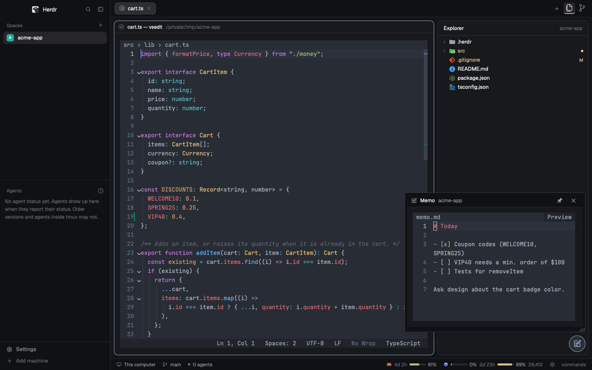

# VS Code

Herdr's main layout turned into a VS Code–style workbench: a file explorer with Material Icon Theme icons, VS Code's git colors and VS Code's right-click menu, and a Source Control panel (repositories, changes, commit graph) on the right; every file but an image opening in its own terminal tab in a VS Code-like editor painted by VS Code's own tokenizer with Atom One Dark, images in a viewer tab, and changes as a VS Code-style diff tab; a pane menu that opens the folder in VS Code or Finder; a status bar that shows how much of the Claude and Codex usage windows is left, with Codex limit resets; and a VS Code-style Settings dialog for the editor's settings, its keyboard shortcuts and the core engine.



## What you see

- **Left sidebar** (268px, 44–480): Herdr's own brand row (46px), spaces and agents lists (equal weights, min 90px each), footer (69px). As Herdr's main layout, except that the spaces list is `vscode-spaces`: each space row shows the icons of the agents in that space (13px, one per kind such as Claude Code or Codex, dimmed to 55% while every agent of that kind is idle; past three kinds the first two and `+N`; a 10px `working` spinner while one works; the tooltip lists them, e.g. `Claude Code ×2 · working, Codex · idle`), right before the green `↑N` / red `↓N`, which are commits ahead of / behind the branch's upstream (`git status --porcelain=v2 --branch`, `# branch.ab`), not changed files. A space without agents shows none.
  - **Spaces with no tabs stay listed.** Herdr closes a space with its last tab (the tab's ×, an editor or shell exiting, `tab.close`); the list keeps it where it was as a closed 30px row told apart by gray alone: the avatar (its initial) on `muted` instead of its color, the name in `muted`, nothing on the right (no agent icons, git tail or label), tooltip `Closed — click to reopen`. In the narrow rail it is the gray avatar alone. The row replaces the space in the same frame Herdr drops it (the list is redrawn from `spaces()` merged with the kept list at render, not after the 250ms check), so the rows below don't move.
- **Tab bar** (42px, `vscode-tabs`): Herdr's tabs, then on the right `+`, icon-only **Explorer** (Codicon `files`) and **Source Control** (Codicon `source-control`) buttons (28px, icon 18px, muted; the label is the tooltip); the shown panel's button is `foreground` on `selected` with a 2px `accent` underline.
- **Work area** (padding 8, gap 8): the active tab's panes (radius 10, 1px `border`, `accent` focus ring, 30px pane header).
- **Right panel** (368px, 280–900, a stack):
  - **Explorer** (`vscode-explorer`): header "Explorer" + folder name (36px, semibold 13px). A tree of the project you work in: the focused terminal's folder, 22px rows, 12px indent per level, chevron 12px, Material Icon Theme icon 16px (file name → extension → default; folders have open/closed icons).
    - Git colors as VS Code: modified `#e2c08d`, untracked/added `#73c991`, deleted `#c74e39`, conflict `#e4676b`. Files show the color on the name plus the letter (`M U A D !`); folders show it on the name plus a 6px dot. Folders take the worst state below them; deletions don't bubble up.
    - It also finds git repos nested up to 3 levels below the folder (up to 200) and merges their status, so a folder of projects shows which project has changes.
  - **Source Control** (`vscode-scm`): header "Source Control" (36px, semibold 13px), then three collapsible sections. Each section header is 22px: chevron 14px, uppercase 11px bold title, details on the right, 1px `border` line above. Rows are 22px. As VS Code's view, the open sections share the panel's height: Repositories and Graph keep their size, Changes takes the rest (with Changes collapsed or without a repo, the last open section does), a collapsed section is just its header and gives its space back. The top edge of a header between two open sections is a 4px sash (row-resize cursor, `accent` on hover and while dragged) that moves height between the nearest open sections above and below it, neither going under its minimum (Repositories 1 row, Changes the 72px commit box plus 1 row, Graph 2 rows); a section's own size shrinks while the others need their minimum.
    - **Repositories** (count badge): every git repo under the project you work in — the focused terminal's folder; editor and diff tabs keep the space's last one, and a fresh space starts at its first terminal's folder: the folder's own repo plus repos nested up to 3 levels (200 at most), as many rows tall as there are repos (1–5) until a sash is dragged, then scrolling. A row: 6px `accent` dot when selected (row on `selected`), repo folder name, branch icon 12px, branch (short hash when detached) with `*` when dirty, and `↑n ↓m` when the branch has an upstream.
    - **Changes** (repo name and file-count badge): a 28px commit message input (`surface`, `accent` border while typing, placeholder "Message (Enter to commit)"), a 28px full-width **✓ Commit on <branch>** button (`solid` when there is a message, else `raised`), then the changed files filling the rest of the section, a virtual list with a scrollbar (rows without a hover fill, as the Graph's): file name in its git color (deleted ones struck through), the folder dimmed, the letter on the right. Colors and letters as the Explorer: `M` `#e2c08d`, untracked `U` / added `A` `#73c991`, `D` `#c74e39`, conflict `!` `#e4676b`. A clicked file opens a diff tab (`HEAD` ↔ working tree).
    - **Graph** (`<branch> · <upstream>` on the right): 40% of the sections' height until a sash is dragged. One 22px row per commit (newest 300): a lane column (12px per lane, at most 12 lanes drawn) with 2px lines, horizontal links where branches join or split, and an 8px dot (a ring for merge commits), lane colors `#ffb000 #dc267f #994f00 #40b0a6 #b66dff` (VS Code's scmGraph colors) by lane; then the subject (semibold on the HEAD commit), up to 2 ref chips (16px, radius 8, 10px: branches with the lane color border and 20% fill, tags on `raised`; `+n` for more), and the author dimmed. An expanded commit (row on `selected`) lists its changed files below it, 22px rows: the lanes that continue below the commit drawn at full height, a 10px indent, the Material icon 16px (file name → extension → default, the Explorer's table), the name in its git color (struck through when deleted), the folder dimmed, the letter on the right (`M` `#e2c08d`, `A` `#73c991`, `D` `#c74e39`, renamed `R` `#73c991`; copies show `A`, type changes `M`). "Loading…" or "No changed files" while there are none.
- **Status bar** (28px, `vscode-status`): machine, branch and agent count on the left. On the right, one group per provider, then a 13px gear (`mods/workspace-chrome/settings.svg`, `dim`, tooltip "Settings") that opens the Settings dialog, then the palette hint:
  - Claude (orange glyph) and Codex (blue-violet glyph without its white tile).
  - Each usage window shows: time to reset (session `3h 25m`; weekly `4d 21h`, `5h 10m` once under a day), a 40×5px bar (green `ansi2` < 70%, yellow `ansi3` 70–90%, red `ansi1` ≥ 90%), the percent.
  - Codex credit balance (e.g. `29,412`).
  - Hovering a group opens a 250px card with each window's name, `N% used`, a full-width bar and `resets 11/12 19:00 (4d 21h left)`.
  - The Claude card ends with a **Reset limits ↗** button that opens `https://claude.ai/settings/usage` (Claude Code has no API for limit resets).
  - The Codex card ends with a **Limit resets** row (`N available`), one dimmed 11px line per available credit (`expires 12/1 04:22`, or `no expiry`), and a full-width 26px **Use a reset** button (dimmed and inert at 0 or while redeeming, when it reads **Redeeming…**). Without the `codex` CLI it shows **Reset limits ↗** to `https://chatgpt.com/codex/settings/usage` instead.
- **Diff tab** (`vscode-diff`, opened from Source Control), named `<file> (<parent short hash>) ↔ <file> (<short hash>)` (the old name on the left for renames; `∅` for a root commit's parent), or `<file> (HEAD) ↔ <file> (Working Tree)` from Changes:
  - Header (30px): breadcrumbs of the last 3 folders `›` the file with its Material icon, then `<old short> ↔ <new short>` (11.5px, `dim`), then ghost buttons **Open File** (a local file: the terminal editor as an Explorer click, images the viewer; a remote file: the viewer) and **Open in VS Code** (local only).
  - One inline column on `#282c34`, editor font 13px, 20px rows: old and new line numbers (two 44px gutters, `#636d83`), the sign (`-`/`+`), then the text. Removed lines on `#e06c7520`, added on `#98c37920`, removed before added in each change. Tabs show as 4 spaces. Long lines scroll sideways.
  - Unchanged runs keep 3 lines of context around each change; 3 or more hidden lines fold into one `⋯ N unchanged lines` row (`#2c313c`, text `#7f848e`).
  - Text colors are VS Code's own (vscode-textmate + oniguruma, its TextMate grammars and Atom One Dark, from `vscode-viewer/vscode/`), with italic, bold and underline; plain `#abb2bf` without node or the engine, or for remote repos.
  - Messages instead of the diff: `Loading diff…`, `Binary file · no text diff`, `File too large to diff`, `Empty file`.
- **Editor tab** (`vscode-viewer`, opened from the Explorer):
  - **Right-click menu** (270px popup, 26px rows, separators like VS Code, shortcut hints as labels only):
    - Folder: **New File…**, **New Folder…** | **Reveal in Finder** `⌥⌘R`, **Open in Integrated Terminal** | **Cut** `⌘X`, **Copy** `⌘C`, **Paste** `⌘V` (only after Cut/Copy) | **Copy Path** `⌥⌘C`, **Copy Relative Path** `⇧⌥⌘C` | **Rename…** `↵`, **Delete** `⌘⌫`.
    - File: **Open**, **Open Preview** (Markdown only), **Open With…** (VS Code Editor (terminal), Herdr Editor (viewer), Open in VS Code, System Default) in place of New File/Folder; the rest as for a folder.
    - Right-clicking empty space in the tree opens the folder menu for the root. A remote folder or file (a space on another machine) has the same items but Reveal in Finder (Finder only sees this computer; Copy Path gives the remote path); its Open With lists VS Code Editor (terminal, on that machine), Herdr Editor (viewer) and Open in VS Code.
    - Rename/New open a 440px dialog with a name field (Rename selects the name without its extension); Delete asks "Are you sure you want to delete '<name>'?" with **Move to Trash**.
- **Terminal editor** (`vscode-viewer/editor/vsedit.cjs`, a terminal tab opened from the Explorer for every file but images, and from a diff tab's Open File):
  - Launched as `sh <herdr home>/mods/vscode-viewer/editor/vsedit.sh <file> [--close-on-exit]` (straight from `sh -c` through `launch.js`, else `tab.new`). With the editor's engine `rust` in `vscode-settings.json` (`"editor.engine"`, else `"core.engine"`: the launcher's `RUST_READY=1`) and `<herdr home>/vscode-core/vsedit` built (its `--api` prints `1`) it runs the Rust editor (`mods/vscode-settings/native/vsedit/`, same screen, keys, files and backups; colored on a worker thread; Go to File, several open files, Go Back / Forward, Save As / Save All and Open Settings / Keyboard Shortcuts (JSON) as in the JavaScript editor); otherwise, and when the binary can't start (it then execs `node vsedit.cjs` itself before touching the terminal), the JavaScript editor. The Rust editor has the JavaScript editor's language features (tsserver / LSP / fallback, each request on a thread of its own), context menu and command palette (also `>` / `@` / `#` / `:` in Go to File), and semantic colors when the theme sets `"semanticHighlighting": true`; only commands neither editor has (multiple cursors, suggestions) show `Not yet in the Rust editor`, and a `keymap.json` command it has never heard of sends the file to the JavaScript editor.
  - Top line: breadcrumbs `folder › folder › file` relative to the enclosing git repo (else the home folder), then the symbols around the cursor, outermost first (`› Shop › buy`, from the document symbols, refreshed 300 ms after an edit), `●` in `#e5c07b` when dirty. A click on the line opens Go to Symbol in Editor. With `breadcrumbs.enabled` false it shows only the file name (and `●`), and clicks do nothing.
  - **Markdown preview** (VS Code's Open Preview icons; `mdpreview.cjs` / `mdpreview.rs`): a Markdown file (its language, `text.html.markdown`) has a ` Preview ` button (`bar` background) at the right end of the top line, from 30 columns; a click is Toggle Preview. **Markdown: Open Preview to the Side** (⌘K V / Ctrl+K V) shows a `vscode-viewer` pane with `{file, preview: true}` right of the editor's pane (`herdr-app do pane.focus --terminal $HC_TERMINAL_ID`, then `pane.split {direction: "right", mod, props}`, then the editor is focused again), or focuses the preview already shown. **Markdown: Toggle Preview** (⇧⌘V / Ctrl+Shift+V; VS Code opens it in place, which a terminal can't) opens it the same way, or closes the shown one (`pane.close`) and focuses the editor. A shown preview is a viewer pane of the same local file in the shared value `vscode-viewer.files` (read from `<herdr home>/shared.json`) that `pane.focus` lands on (`herdr-app status`'s `focused_pane`), so a closed pane still listed there doesn't count. The preview shows the saved file and re-reads it every second. Without `$HC_TERMINAL_ID` or `herdr-app` (a remote machine, outside Herdr) the status bar says `Preview: open from the Explorer on this computer`; any other language says `Preview: not a Markdown file`.
  - Text on `#282c34`, default `#abb2bf`, every visible line colored by vscode-textmate with the akamud Atom One Dark 2.3.0 theme (24-bit SGR, italic/bold/underline/strikethrough from the theme). Gutter numbers `#636d83`, active `#abb2bf`; current line `#2c313c` (when nothing is selected); selection `#3e4451`; current find match `#42557b`, other matches `#324365` (`editor.findMatchHighlightBackground` over the background). Opaque `colors` from `theme.json` override these. Bar cursor in `#528bff`.
  - **Problems** (the language server's diagnostics; hints are not drawn): an underline under the range in `editorError.foreground` `#f14c4c`, `editorWarning.foreground` `#cca700` or `editorInfo.foreground` `#3794ff` (VS Code's dark defaults; One Dark doesn't set them) — written `SGR 4` (plain) and `58:2::r:g:b` (underline color), `59` after it; not VS Code's squiggle (`4:3`): a curly one showed no underline in Herdr's terminal; an empty range underlines the character at it. They show right after opening (the server starts with the first outline; tsserver is asked `geterr`). The gutter's first column shows `●` in the most severe problem's color on its lines.
  - **Decorations** (`decorations.cjs`, computed for the visible lines only and cached per text version): indent guides `│` at each indent step (the file's detected indent size) of the leading whitespace, and on blank lines from the content lines around them (VS Code's rule), in `editorIndentGuide.background` `#abb2bf26` (blended: `#3c4049`); the cursor's block — the body below a header line, the block above a footer line, else the block the line is in — in `editorIndentGuide.activeBackground` `#626772`; never over text or a selection. The bracket `()[]{}` before the cursor (else after it) and its partner on `editorBracketMatch.background` (One Dark's `#515a6b`; the akamud theme has none), brackets in strings/comments/regexes not counting (vscode-textmate's standard token type, `(meta >>> 8) & 3`), the scan stopping after 20,000 characters. The word at the cursor (identifier characters) highlights its whole-word occurrences on `editor.wordHighlightBackground` (One Dark Pro's `#d2e0ff2f` → `#474d59`) once the cursor rests 250 ms; a one-line, non-blank selection highlights its other exact, case-sensitive matches at once on `editor.selectionHighlightBackground` (VS Code's `#add6ff26` → `#3c4552`). Both mark the overview ruler (`editorOverviewRuler.wordHighlightForeground` / `selectionHighlightForeground`, `#a0a0a0cc`), over the whole file up to 20,000 lines; while Find is open its matches replace them. Background priority: find match, selection, bracket, occurrences.
  - **Inline suggestions** (VS Code's inline completions, as Copilot shows them): a suggestion for the cursor's position in `editorGhostText.foreground` (VS Code's `#ffffff56`, blended: `#717378`), right after the cursor with the rest of the line moved after it; a suggestion of several lines pushes the lines below down (the rest of the cursor line follows its last line), and clicks below map past those rows. The status bar's last item is the provider: `Ollama`, `Ollama …` while asking, `Ollama: off`, `Ollama: error`, `Ollama: paused`, `Ollama: limit`, `Ollama: ollama pull <model>` (the model isn't pulled: nothing is asked), `Ollama: chat model` (an instruct model: still asked, the pointer recommends a base model); hidden while the provider is `off`, or can't run here (Ollama not installed) and `editor.inlineSuggest.enabled` isn't set. The pointer on it shows today's usage in the message area: `Ollama qwen2.5-coder:1.5b-base · today 12 requests · ~3.1k in / 40 out tokens · p50 140 ms, p95 900 ms` (tokens are characters ÷ 4; latency from request to reply), and before it why it is paused or what happened to the last reply (`the last reply was dropped: it was prose, not code`, `… was empty`).
  - **Gutter**: a cell for a problem's `●` or, on the cursor line, the light bulb `◆` in `editorLightBulb.foreground` `#ffcc00` (when its problems have quick fixes: asked 250 ms after the line, its problems or the text change, only from a running language server), the line number (`#636d83`, active `#abb2bf`), the git change cell, the fold chevron cell, then the text.
  - **Git changes** (`gitgutter.cjs`, VS Code's quick diff): the buffer against the file's `HEAD` version (`git cat-file blob HEAD:<path>`), diffed 300 ms after the last edit (Myers' line diff, common ends trimmed, past 1,000 edits the rest of the middle is one change; no decorations past 200,000 lines). Added lines get `▎` in `editorGutter.addedBackground`, modified ones `▎` in `modifiedBackground`, deleted lines a `▁` under the line before them (`▔` over the first line) in `deletedBackground` — One Dark Pro's `#109868` / `#948b60` / `#9a353d`, the akamud theme has none. The same marks go on the overview ruler (`editorOverviewRuler.added/modified/deletedForeground`, VS Code's: the bar color at 60%), under the other marks. A file new in the index is all added; an untracked file or one outside a repo shows nothing. `HEAD` is read again on save and when `.git/HEAD`, the index or `logs/HEAD` change (checked every 3s; in a worktree, its own git dir). A click on a bar moves the cursor to that line.
  - **Folding** (`folding.cjs`, VS Code's indentation strategy): a line followed by deeper-indented lines heads a range up to the last line before one at most as deep (blank lines in between included, except in off-side languages: Python, YAML, CoffeeScript, Pug, Sass, F#, Nim); `// #region` … `// #endregion` (also `#region`, `# region`, `/* #region */`, `<!-- #region -->`, `--#region`) fold from the start through the end marker; at most 5,000 ranges (the outermost kept). Chevrons as VS Code's `showFoldingControls: mouseover`: `⌄` on every header while the pointer is on the gutter, `›` on collapsed ones always, in `editorGutter.foldingControlForeground` (`#c5c5c5`). A collapsed fold shows its header on `editor.foldBackground` (the selection at 30%: `#2f333d`) followed by ` ⋯` in `editor.foldPlaceholderForeground` (`#808080`); its lines are skipped by painting, ↑/↓, PageUp/PageDown, the wheel, the scrollbar, the overview ruler and clicks, line numbers stay the file's.
  - **Word wrap** (`wrap.cjs`, the Rust editor's `wrap.rs`; VS Code's `editor.wordWrap`, default `"off"`): `"on"` wraps at the window (the text width less the scrollbar's column and one for the caret), `"wordWrapColumn"` at `editor.wordWrapColumn` (80), `"bounded"` at the smaller of both. A line breaks after spaces and `})]?|/&.,;` (and VS Code's CJK closing punctuation), before `([{+` (and the CJK openers), and between ideographs, as VS Code's default `wordWrapBreakBefore/AfterCharacters`; a token longer than the row breaks where it doesn't fit. Widths are display widths (CJK, Hangul and emoji 2, tabs to the line's tab stops). Continuation rows get `editor.wrappingIndent` (`"same"` default: the line's indentation; `"none"`, `"indent"` +1 level, `"deepIndent"` +2; none when a 2-column character wouldn't fit after it) with indent guides in it, a blank line number, the git bar (a deletion mark under the line's last row / over its first), no fold chevron or problem mark. Every view feature goes by these rows: ↑/↓ and PageUp/PageDown move by row keeping the column; Home goes to the row's start, then VS Code's first non-blank / column 0; End to the row's end (before its break space), then the line's; ⌃A / ⌃E (cursorLineStart / cursorLineEnd) the row's edges; clicks and drags land on the clicked row; the wheel, both scrollbars (no horizontal one while every row fits), the overview ruler, CodeLens rows, inline-suggestion ghost rows (below the cursor's row), folds (a collapsed region hides all its rows), find/selection/occurrence/bracket/problem backgrounds and underlines across rows, and popups (hover, peek, quick fix, menus, rename) at the cursor's row. Resizing rewraps; the cursor keeps its line and column. Each line's rows are computed when first needed and cached by its text and the width (a 500 KB line wraps in ~5 ms; only edited lines are wrapped again). **View: Toggle Word Wrap** (⌥Z / Alt+Z, as VS Code's) and the status bar item switch `off` ↔ `on` (or the configured mode) for this file and session, as VS Code's toggle does; the settings file is not written.
  - Tabs shown to the file's indent size; CJK, Hangul and emoji are 2 columns wide; control characters show as control pictures (`␉`-style).
  - The first frame (breadcrumbs, plain text, status bar) is painted as soon as the file is read; the grammar loads after it and the screen repaints in color. Lines over 4,000 characters (minified bundles) are tokenized in ~1,000-character pieces carrying the rule stack (cut after `;`/`}`), at most 25 ms per frame, the visible part first; painting a long single-width line starts at the first visible column.
  - Mouse: dragging a selection past the left/right edge (or into the gutter) or above/below the text auto-scrolls every 40 ms (faster the farther out) until release; wheel buttons 66/67 and Shift+wheel scroll sideways. The cursor keeps 4 columns of margin when it moves past an edge.
  - **Scrollbars** (`scrollbar.cjs`, shared with the hex viewer), VS Code's look: a vertical bar in the last column of the text rows, only when the file is taller than the view (or scrolled), and a horizontal bar on the row above the status bar (from the text's first column), only when a line in view is wider than the text area (a line over 1,000 characters counts its length, never measured). Each takes its row/column away from the text. The track is the background; the thumb is `scrollbarSlider.background` `#4e566680` (`hoverBackground` `#5a637580` with the pointer on it, `activeBackground` `#747d9180` while dragged), blended over the background, sized visible/total (at least 1 cell) and placed to an eighth of a cell with block elements (`▁`–`▇` vertical, `▏`–`▉` horizontal, colors swapped where the thumb starts a cell). The vertical bar scrolls until the last line is at the top (scroll beyond last line), the horizontal one to 5 columns past the widest line in view. Overview-ruler marks `━` on the vertical bar: the cursor line `#528bff`, find matches `editorOverviewRuler.findMatchForeground` (while Find is open), the selection's other end `#a0a0a0cc`, problems `editorOverviewRuler.errorForeground` `#ff1212b3` / `warningForeground` `#cca700` / `infoForeground` `#3794ff` as a whole cell `█` (errors win a shared cell, also over the cursor's mark). A file with problems always shows the vertical bar, as VS Code's ruler always shows, even when it fits; then each mark sits beside its line's row. Mouse: a track click jumps so the thumb centers on the pointer and keeps dragging; dragging the thumb scrolls (the pointer may leave the bar); the wheel over the horizontal bar scrolls sideways; a click on a bar never moves the cursor, selects or opens the menu. While a bar shows, or the file has more than one line (for the fold chevrons), the editor asks for any-motion reports (`CSI ? 1003 h`, else back to `? 1002 h`) so the thumb highlights on hover; a hover change repaints only that bar (cursor saved/restored with `ESC 7`/`ESC 8`), not the frame.
  - **Binary files** (a NUL byte, in the first 8 KB for files over 50 MB): a centered dialog "The file is not displayed in the text editor because it is binary." with **Open in Hex Viewer** (Enter) and **Open Anyway** (decodes as text, NUL as `␀`). Clearly binary names (`.DS_Store`, images, archives, executables and libraries, `.wasm`, fonts, `.pdf`, `.sqlite`/`.db`, audio/video) go straight to hex.
  - **Hex viewer** (`hexview.cjs`, read-only, same breadcrumbs/status bar): a header `Offset    00 01 … 0F  Decoded Text` in `#636d83`, rows `offset (8 hex digits)  16 bytes as hex in groups of 8  ASCII` with the offset `#636d83` (`#abb2bf` on the cursor row), zero bytes `#5c6370`, printable ASCII `#98c379`, other bytes `#d19a66`, non-printables as `·`. The byte under the cursor is on `#42557b` in both panes, a selection on `#3e4451`. The file is read in 64 KB chunks (an LRU of 64), never whole. Keys: arrows (bytes/rows), PageUp/PageDown, Home/End (file start/end), Shift extends the selection, wheel scrolls, click/drag in either pane selects, the editor's vertical scrollbar in the last column (over the rows, when they don't all fit; drag/jump/hover as in the editor, the cursor stays); `⌃G` go to offset (`0x1F`, `1fh`, a–f digits = hex, plain digits = decimal); Find (`⌘F` / `Ctrl+F`) spaced hex bytes (`de ad be ef`) or text (`"quoted"` forces text), Find Next / Previous (`F3`, `⌘G` / `⇧F3`, `⇧⌘G`), wrapping (a match becomes the selection); Copy (`⌘C` / `Ctrl+C`) copies the selection (else the cursor byte) as spaced hex (up to 1 MB); Close Editor (`⌘W`; `Ctrl+W`, `Ctrl+F4` on Windows) or Esc quits (Esc first clears a selection); every key is the editor's for this OS, user keys included. Status bar: `Offset 0x… (dec)`, `Byte 0x41 65 01000001`, `N selected`, size, `Hex`; above it a data inspector line: int8, uint8, int16 LE/BE, int32 LE/BE, float32 LE/BE at the cursor.
  - **Error page** when a file can't be opened (not found — only when opened from the Explorer, by hand a missing file is a new one —, permission denied, larger than 50 MB, a read error, a crash): the whole tab shows `⚠`, **The editor could not be opened** (bold), the file name, the reason in `#e06c75`, and buttons **Try Again** (reloads), **Open in VS Code** (`code <file>`), **Reveal in Finder** (`open -R`), **Close** (Esc or this OS's Close Editor key: ⌘W / Ctrl+W); the focused button white on `#4d78cc`, ←/→/Tab move, letters t/o/r/c, mouse clicks. Nothing is printed into the shell when opened from the Explorer.
  - Bottom status bar (`#21252b`/`#9da5b4`): messages on the left (Saved, Find: 3 of 12, Renamed 4 occurrences in 2 files, errors); with no message, the problem at the cursor (its first line, then the source like `ts(2322)`, in its severity's color), else the file's counts `⊗ 1  ⚠ 2` (`  ℹ 3` with information); on the right `Auto Save` (when `files.autoSave` is on), `Ln X, Col Y (N selected)`, `Spaces: N` or `Tab Size: N`, `UTF-8` (`UTF-8 with BOM`), `LF`/`CRLF`, `Wrap` (`Wrap 80` for `wordWrapColumn`/`bounded`) or `No Wrap` in the line number color, VS Code's language name (Plain Text when there is no grammar). Clicks: Ln/Col opens Go to Line; Spaces/Tab Size a quick pick **Indent Using Spaces** / **Indent Using Tabs**, then the size 1–8 (the current one reads `Configured Tab Size`), for this file only (not the settings); `LF`/`CRLF` **Select End of Line Sequence** (the file is written with it on the next save and counts as changed until then); `Wrap`/`No Wrap` toggles word wrap for this file (the pointer on it says the mode and column in the message area); the language name **Select Language Mode** (Plain Text and every shipped grammar's language, `(scope)` beside it, sorted by name), which re-tokenizes the file and switches the comment tokens and the language server. The encoding is shown only.
  - Find widget (top right, 60 columns at most, `editorWidget.background`), VS Code's row: a `▸`/`▾` button (shows/hides the Replace row), the Find field (`input.background`, placeholder `Find` in `#636d83`), toggles `Aa` (Match Case), `ab` (Match Whole Word), `.*` (Use Regular Expression) — on: white on `inputOption.activeBackground` (`focusBorder` at 40%, `#528bff66` over the widget) —, the count `N of M` (`? of M` when the selection isn't a match, `20000+` past the cap) or `No results` in `#e06c75`, and `↑` `↓` `×` (previous, next, close). The Replace row: the Replace field, then **Replace** and **All** buttons. Under 40 columns only the fields show. Go to line and the auto-save delay prompt sit on the first text row.
  - Overlays use `editorWidget.background` `#21252b` with `editorWidget.border` `#3a3f4b` box lines:
    - **Context menu** at the mouse (or under the cursor for Shift+F10), VS Code's default editor menu: Go to Definition `F12`, Go to Type Definition, Go to Implementations `⌘F12`, Go to References `⇧F12`, Peek `›` (Peek Definition `⌥F12`, Peek References, Peek Implementations, Peek Type Definition) | Find All References `⌥⇧F12`, Find All Implementations, Show Call Hierarchy `⌥⇧H` | Rename Symbol `F2`, Change All Occurrences `⌘F2`, Format Document `⌥⇧F`, Refactor... `⌃⇧R`, Source Action... | Cut `⌘X`, Copy `⌘C`, Paste `⌘V` | Command Palette... `⇧⌘P`. Separators `├─┤`; the highlighted item is white on `button.background` `#4d78cc`; items with no provider for the language are `#636d83`. The submenu opens beside its row.
    - **Quick pick** (top center, up to 80 columns, 12 rows): an input on `#1b1d23`, then results with matched letters bold `#d7dae0`, details `#636d83` and key labels on the right; the selected row `#3e4451`.
    - **Results panel** (bottom 40% of the screen, above the status bar): a `#21252b` header `REFERENCES   4 results in 2 files` (or `IMPLEMENTATIONS`, `INCOMING CALLS · name`) with `Enter open · Esc close`, then `▾ file  folder  (count)` rows and `line:col  preview` rows.
    - **Peek** (10 rows under the cursor line): a header `file  folder  — Definition` with `1 of 3 · ↑↓ · Enter open · Esc close`, 8 colored lines on `peekViewEditor.background` `#1b1d23` around the target (the target line `#2c313a`, its range `#42557b`), and a `#528bff` rule below.
    - **Inline input** (rename, change all): a 3-row box with a `#528bff` border under the symbol, the text preselected.
    - **Dialog** (centered, at least 44 columns, `#528bff` border): bold title, a detail line, buttons on the right; the focused one white on `#4d78cc`.
    - **Hover** (`editorHoverWidget.background` `#21252b`, `editorHoverWidget.border` box lines): above the word (below it without room), up to 80 columns and 14 rows (`…` when there is more): the problems at that spot (message and source), a rule, then the language server's Markdown as plain text — code blocks as their lines in `#d7dae0`, headings, emphasis, inline code ticks, links and JSDoc `{@link}`s reduced to their text, `---` as a rule, wrapped at spaces.
    - **Quick fix menu**: the context menu's look, under the cursor, the first item selected.
- **Viewer tab** (`vscode-viewer`, opened from the Explorer for images, videos, Markdown's Open Preview and remote files whose machine has no editor yet, or with Open With → Herdr Editor):
  - Header (30px): breadcrumbs of the last 3 folders `›` the file with its Material icon, then ghost buttons **Wrap**, **Revert** (only when edited), **Install Editor on <machine>** (a remote file whose machine has no editor yet: asks the Explorer to install it, as the confirm dialog's yes; then **Installing…**), **Open in VS Code**, **Save ⌘S** / **Saved**.
  - Herdr's built-in editor on `#282c34` with text `#abb2bf`, 13px, line numbers.
  - Status strip (22px): language name (VS Code's name for the file type), line count, `Spaces: N`/`Tabs`, `UTF-8`, `LF`/`CRLF`.
  - **Images** (`png jpg jpeg gif webp bmp ico svg tif tiff`): the image centered on `#282c34` with a `#323842` 8px checkerboard, 16px padding, shrunk to fit and never enlarged. Header keeps breadcrumbs and **Open in VS Code** (no Wrap/Save). Status strip: format (`PNG`, `JPEG`, `SVG`, …), `W × H` pixels (from `sips`), size (`B`/`KB`/`MB`, one decimal).
  - **Videos** (`mp4 m4v mov webm mkv avi`): a Quick Look still (`qlmanage -t`) shown as an image, with an **Open in Player** button (`open`). Status strip: format (`MPEG-4`, `QuickTime`, …), size.
  - **Remote images and videos**: fetched first into the viewer cache in 4 MB pieces (`hc exec --on` + `dd`, verified by size; files over 200 MB are refused with a message), showing `Fetching from <machine>… N%`; fetched again when the file's mtime or size changes. The cache is trimmed to 1 GB, oldest first.
  - **Markdown** (`md markdown mdx mkd`): opens rendered (`TextView.markdown`, 14px, padding 28/16, scrollable, selectable) with an **Edit** button; in the editor the button reads **Preview**. Wrap shows only in the editor. The prop `preview: true` (the terminal editor's Markdown preview) shows any file this way. A local file shown rendered is re-read every second (else every 3 s), so the preview follows saves.
- **Settings dialog** (`vscode-settings`, 780×600, `popover`): a 44px header with two page tabs, **Settings** and **Keyboard Shortcuts** (the current one 14px semibold `foreground` over a 2px `accent` underline, the other 13px `muted`), the page's file name (`vscode-settings.json` / `vscode-keybindings.json`, 11px `dim`), `✓ Saved` (`done`, 1.5s after each write) and `Esc`; a red line under it when the file can't be read as JSON or a write fails; a scrolling body of sections (CORE ENGINE, FILES, EDITOR, 11px `dim`) whose rows read `Category: **Name**`, a one-line `muted` description and the control on the right; a 52px footer **Open settings.json**, **Reset to defaults**, and **Close** (`solid`).
  - Core: Engine — segmented **JavaScript** | **Rust** (`core.engine`, default `js`). Below it `Rust core: built (v1.0.0)` (`done`), `Rust core: v0.1.0 is out of date (rebuild it)` or `Rust core: not built`; with Rust selected and no binary of major version 1, a **Build Rust core** button.
  - Editor: Engine — segmented **JavaScript** | **Rust** (`editor.engine`; absent, it shows and follows the core's engine). Below it `Rust editor: built (v1.0.0)`, `Rust editor: … is out of date (rebuild it)` (its `--version` doesn't end in `(api 1)`) or `Rust editor: not built`. The **Build Rust core** button (one build makes both binaries) sits on the core's row while the core is Rust, else on this row, and shows while a chosen Rust engine's binary is missing or out of date. Reset to defaults removes `editor.engine`.
  - Files: Auto Save — segmented Off | After Delay | On Focus Change (`files.autoSave`); Auto Save Delay — − [seconds] + (`files.autoSaveDelay`, 0.1–3600; the steppers move by 0.1 below a second, by 1 above); Trim Trailing Whitespace, Insert Final Newline — switches (34×18, `accent` when on).
  - Editor: Format On Save — switch; Tab Size — − [n] + (1–16); Insert Spaces — switch; Inline Suggestions — switch (`editor.inlineSuggest.enabled`; absent shows on, Reset to defaults removes it); Inline Suggestion Provider — segmented Ollama | LM Studio | Codestral | Mercury | Off; a file's `"deepseek"`, no longer offered, reads as Off (picking another one moves a shared `editor.inlineSuggest.model` / `.endpoint` to the provider left's own keys and starts from the new one's own); for Ollama and LM Studio Inline Suggestion Server — an address field (`editor.inlineSuggest.<provider>.endpoint`, empty: `http://127.0.0.1:11434` / `http://127.0.0.1:1234`, another machine allowed), checked as it is typed (red border and `Start the address with http:// or https://…`, `Not a server address…`, `The port is 1–65535`), written on Enter or blur when valid, and **Test** (one 16-token completion with that address and model: `Works: …`, or `… is not running at …`, `model … not found (…)`, `FIM not supported: …`); below it (not when Off) Inline Suggestion Model — a text field for another model name (Enter writes `editor.inlineSuggest.<provider>.model`) and the provider's models as chips: the default first (`""` in the file), for Ollama the models from `/api/tags` and for LM Studio from `/v1/models` (embedding models left out) with recommended FIM models marked `(recommended)` and ones the server doesn't have marked `(not pulled)` (a server that doesn't answer: the recommended ones only, unmarked), the file's own model when none of them; and for a paid provider API Key — a masked field with **Save** (Enter too), **Remove** (when one is stored) and **Test** (when there is a key: one 16-token completion, `Works: a completion in 412 ms.` or why not), and a line saying where the key is with only its ends (`Saved in the macOS keychain: sk-a…mnop`, `Saved in vscode-secrets.json (mode 600): …`, `From the environment: …`) or how to add one. The dialog runs `node <herdr home>/mods/vscode-viewer/editor/inline.cjs --models | --key | --save-key | --remove-key | --test <provider>`; Save writes the typed key to a file in a new mode-700 folder of the herdr home (Herdr's `exec` has no stdin), `--save-key` reads and deletes it and stores the key with `security -i` reading `add-generic-password -U -s herdr-vscode-<provider> -a herdr -w "<key>"` on stdin (so no command line holds it), else in `vscode-secrets.json` at mode 600; the key is never shown again in full, never written to settings.json, and only the Test button sends a request; Word Wrap — segmented Off | On | Column | Bounded (`editor.wordWrap`); Word Wrap Column — − [n] + (1–500); Wrapping Indent — segmented None | Same | Indent | Deep Indent.
  - **Keyboard Shortcuts** page: a 28px search box "Type to search in keybindings" with `N of M` beside it; a 26px column header **Command** · **Keybinding** (160px) · **Source** (56px); rows (36px, `border` between) with the title (12.5px) over the command id (10.5px `dim`), the key as a chip in the style VS Code uses on the editor's OS (`--table` gives it): macOS glyphs (`⇧⌘K`, `⌥↑`, `⌘K ⌘J`), Windows/Linux text (`Ctrl+Shift+K`, `Alt+UpArrow`, `Ctrl+K Ctrl+J`; ⌘ is `Windows` / `Super`), `F12`, `—` without one, `Default` (`muted`) or `User`, and small buttons **Change** (**Add** without a key), **Remove** (with a key) and **Reset to default** (when `vscode-keybindings.json` has entries for the command). Change replaces the table with VS Code's recorder: "Press desired key combination and then press Enter", the command, the key pressed so far as a 32px chip (a second keystroke makes a two-step chord, a third starts over, as VS Code's), `N existing commands have this keybinding` (`ansi3`) and **Cancel** / **Save**. Under a User row whose key (either keystroke of a chord) Herdr doesn't pass to terminal programs, an 11px `ansi3` note — `⇧⌘D doesn't reach the editor: Herdr runs pane.split:down (global) for it. Passing it sends ⇧⌘D to the program in every terminal, so pane.split:down (global) no longer runs while a terminal has focus.` (or, for a ⌘ key Herdr doesn't bind, that nothing is lost) — and **Pass this key to the editor in Herdr**. The footer has **Open vscode-keybindings.json** and **Close**.
- **Memo button** (`vscode-memo`): a 40px round button with a 20px pencil-on-note icon (theme `raised`, `border`, small shadow; accent border and icon while the panel is open; tooltip "Memo") floating over the window, first at its bottom-right corner (16px in from the right, 16px above the status bar). A click opens the **memo panel**: a 440×340 window (min 260×160) above the button and to its left, with a 30px title bar (icon, **Memo**, the space's name, pin, ×) over the terminal editor showing `<space folder>/.herdr/memo.md`, word wrap on, no breadcrumbs, hovers, code lens, inline suggestions or server offers. A 5px border around it (12px at the bottom, with a dotted grip in the bottom-right corner) resizes from each side with the OS's resize pointers, and from each corner's 16px square.

## How it behaves

- **Explorer button / Source Control button** toggle the right panel and pick its page; the panel's state is one for all spaces (switching spaces doesn't open or close it). `cmd-e` toggles the panel.
- **Explorer clicks:** folder = expand/collapse; any file but an image (code, text, Markdown, dotfiles like `.env`, files without or with an unknown extension: the editor tells text by its content as VS Code does, and a file with NUL bytes in its first 8 KB opens in the hex viewer) = a new terminal tab named after the file running `sh <herdr home>/mods/vscode-viewer/editor/vsedit.sh <file> --close-on-exit` (the launcher: the Rust editor when chosen, else `node vsedit.cjs`), started in the Explorer's root without a shell first (`launch.js`: `hc run` with `herdr.space`/`herdr.tab` labels, which Herdr shows as a new tab, then `tab.rename` and `tab.select`; `tab.new` would run it inside `$SHELL -lic`, showing an empty shell while the rc files load), so the tab closes when the editor exits; mod tabs, remote spaces and a failed or unseen launch use `tab.new {argv: ["exec", "sh", …vsedit.sh, …]}`; images (`png jpg jpeg gif webp bmp ico svg tif tiff`) = a `vscode-viewer` tab; `cmd`+click = `code <file>` (a remote file: VS Code Remote-SSH, as the menu's Open in VS Code).
  - **A file on a remote machine** (any but an image) (a space on another machine) opens in the Rust terminal editor **on that machine** (VS Code Remote's way: a remote space's tabs hold only that machine's terminals, so the editor, its files and its language servers are all there): `tab.new {argv: ["exec", "sh", "<home>/.local/share/herdr-vscode/<version>/vsedit.sh", <file>, "--close-on-exit", "--os", "mac", "--settings", <text of vscode-settings.json>, "--keybindings", <text of vscode-keybindings.json>]}` in the remote space. The bundle comes from `vscode-settings/native/build-remote.sh` on this computer (`<herdr home>/vscode-core/remote/<arch>/`).
    - First open on a machine: `uname -sm; printf "%s\n" "$HOME"` there (kept for the session) picks the platform: `Linux aarch64|arm64` → `linux-aarch64`, `Linux x86_64|amd64` → `linux-x86_64`, `Darwin arm64|x86_64` → `macos` (one universal bundle). A machine without `sh`, or whose `uname` is Git Bash's (`MINGW…`/`MSYS…`/`CYGWIN…`), is asked `powershell -NoProfile -NonInteractive -Command '$env:PROCESSOR_ARCHITECTURE; $env:LOCALAPPDATA'`: `AMD64` → `windows-x86_64`, `ARM64` → `windows-aarch64` (`hc machine ls` doesn't report a machine's OS). Then `test -f <version folder>/manifest.json` there says whether this build is installed. Not installed: the file opens in the viewer (with **Install Editor on <machine>**) and the shipped `confirm` dialog asks **Install the editor on orangepi (2.8 MB)?** on every such open; its Confirm runs `vscode-explorer.install-remote` for the tree, which marks the machine approved (`vscode-explorer.remote-approved`) and installs. An approved machine installs a new build on its own when a file opens (toasts `Installing the editor on <machine>…` and `Editor installed on <machine>`), then opens the editor.
    - Install, always run from this computer with the bundle on stdin (`hc exec -i --on <machine> --timeout 300 -- …`; nothing runs as a tab). Linux and macOS (`REMOTE_INSTALL`, `sh -c` with every value an argument): only into `~/.local/share/herdr-vscode/<x.y.z>-<12 hex>` (any other root or version is refused); the bundle goes to a `mktemp -d` folder there, its sha256 (`sha256sum`, else `shasum -a 256`) must match the manifest, it is unpacked (`tar --no-same-owner`), `chmod 755` on the binaries, `vsedit --api` must print 1, the manifest is written, then the folder is renamed into place whole (an existing version folder with its manifest = already current). Windows (`windowsInstall`, `powershell -NoProfile -NonInteractive -EncodedCommand <UTF-16LE base64>`, so no command-line quoting; the root, version and sha256 are checked first and written as single-quoted literals, `'` and curly quotes doubled): `%LOCALAPPDATA%\herdr-vscode\<version>`, stdin copied to a `.install.<guid>` folder, `Get-FileHash`, `tar.exe -xzf`, `vscode-core.exe --version`, `Move-Item` into place. Of the version folders both keep the newest two. A failure is a warning toast and the viewer.
    - Settings and keybindings: this computer's files win; they are passed on every launch and written to `~/.local/share/herdr-vscode/` when they differ, so a change made there from the editor's palette lasts until the next launch. The keys are this computer's OS (`--os`, from `window().platform`): the keyboard is here. Hot-exit backups stay on the machine (`~/.local/share/herdr-vscode/backups`).
    - Falls back to the viewer: images, Open Preview, Open With → Herdr Editor, a **Windows** machine (the Rust editor's terminal layer is POSIX: termios, poll, SIGWINCH; one info toast; its bundle carries only `vscode-core.exe` for now), a system without a bundle (32-bit ARM, BSD…; one info toast), no bundle built here (one toast naming `build-remote.sh`), not installed yet or refused, an unreachable machine, a failed install.
  - The tree follows the focused terminal's folder. While an editor, viewer or diff tab is focused it keeps the space's last project (the terminal editor tab starts in the Explorer's root, so it doesn't move the tree either); a new space starts at its first terminal's folder, else the space folder. Each project keeps its last tree and git state, so switching back shows it at once and refreshes behind it. It refreshes on file changes (a remote tree, which Herdr can't watch, every 3s instead), every 10s and after a menu file operation, and lists at most 500 entries per folder and 5,000 in total.
  - Every other local space (not `machine` spaces) is loaded in the background too: its root folder, the folders expanded there before, and its git state, 3s after start, 2 spaces at a time, again every 10 minutes and as soon as a new space appears; a space loaded in the last 2 minutes is skipped, and spaces on the same folder load it once. Its root is the one the tree would take there (its first terminal's folder, else the space folder), pinned so switching there with an editor tab focused shows it. So switching to any space shows its tree without "Loading files…".
  - The trees survive a restart: kept in `localStorage` (`vscode-explorer.cache`) and shown at once on start, then refreshed (the shown space right away, the others by the background load).
- **Explorer drag and drop** (`dnd.js`; the tree scrolls itself and draws only the rows on screen, so the pointer's y names a row): files dropped from Finder are copied (`cp -R -n`, a free "a copy" name, never moved or overwritten) into the folder under the pointer: a folder row is that folder, a file row its folder, empty space the root; then that folder opens and the first copy is selected and scrolled to. A Finder drag is not lit while it is over the tree: Herdr reports it only as pointer moves, like a hover, and telling them apart by the window being inactive lit the tree on plain hovers too. On a remote tree the drop uploads instead, under the same free names, never over an entry: toasts "Uploading <name or N items> to <machine>…" then "Uploaded …" (or the error), as a background hc terminal (`ops.js` UPLOAD: each item a tar, sent in 6 MB `hc exec -i --on` pieces, 10 min a piece, into a temp folder beside the target, then renamed in; executable bits kept), so a large drop isn't cut at exec's 30 s. A tree row pressed and dragged 4px onto a folder (or a file, meaning its folder) moves there (`mv -n`, also on a remote machine); with Alt/Option held at release it is copied under a free name. A name clash on a move or a folder into itself is an error toast; a move into its own folder does nothing. While dragging, the target folder and its rows (the whole tree for the root) take `hover` and the item's icon and name follow the pointer; Escape cancels; leaving the tree with a folder cancels. A file dragged out of the tree toward the panes is handed to `vscode-tabs`' drag overlay (below, the same one a dragged tab uses; `{ drag: {source: {file, on, folder}, request: "vscode-explorer.open-at", into, title, back, id} }`, no `bar`, so the panes' area is the box around the shown pane headers, `drag.js headersRect`): the pane under the pointer shows its half and the file name follows the pointer; the release opens the file beside that pane (`split.js`: focus that pane and wait until it is focused, then Open to the Side's `openFile` with `place` right / down, so a warm editor's `terminal.keep`, `terminal.open`, or a viewer's `pane.split`; left / up then `pane.swap`), never first as a tab of its own. A file already open in an editor of this space is not opened twice (two editors would fight over saving): in the dropped-on tab it is only focused, from another tab that editor moves there (`move.js` MOVE_REQUEST); a viewer opens again. A remote tree opens it on its machine as its clicks do. The pointer back over the rows hands the drag back (the overlay closes and sets `vscode-tabs.drag-back` to the drag's id), so a drop into a folder still works; Escape, a release outside the panes or a press cancels. Open editor tabs of a moved file keep the old path (as Rename).
- **Explorer keys** (`keys.js`, VS Code's explorer keys for this OS): a click selects the row and gives the tree the keyboard; the selected row is on `selection` while the tree has it, else `selected`. ↑/↓ move the selection (kept on screen); → opens a folder, then goes to its first child; ← closes an open folder, else goes to its parent. macOS: Enter = Rename…, Space / ⌘↓ = open, ⌘C / ⌘X / ⌘V, ⌘⌫ = Delete, ⌥⌘C / ⇧⌥⌘C = Copy Path / Copy Relative Path, ⌥⌘R = Reveal in Finder. Windows/Linux: F2 = Rename…, Enter / Space = open, Ctrl+C / Ctrl+X / Ctrl+V, Delete; Copy Path Shift+Alt+C (Linux Ctrl+Alt+C), Copy Relative Path Ctrl+Shift+Alt+C (Linux only; Windows' is a chord), Reveal Shift+Alt+R (Linux Ctrl+Alt+R). Each runs the menu's item (`menu.js explorerAction`) on the selected row; Paste with nothing selected goes into the root. Other keys pass on.
- **Explorer right-click menu:**
  - Open opens the file as a click does; Open Preview (Markdown) opens it rendered in the viewer. Open With: VS Code Editor = the terminal editor, Herdr Editor = `vscode-viewer`, Open in VS Code = `code`, System Default = `open`.
  - Reveal in Finder = `open -R` (Windows `explorer.exe /select,`, Linux `xdg-open` on the parent; `paths.js revealCommand`). Open in Integrated Terminal = `terminal.open {folder, place: "tab"}` in the folder (a file's parent folder).
  - Cut/Copy remember the path (shared value `vscode-explorer.clipboard`); Paste goes into the right-clicked folder (a file's parent): copy = `cp -R -n`, cut = `mv -n`, then the clipboard clears. An existing name gets Finder's `name copy.ext`, `name copy 2.ext`…; nothing is overwritten, and a folder can't go into itself.
  - Copy Path / Copy Relative Path (relative to the Explorer root) go through `pbcopy` (Windows PowerShell `Set-Clipboard`, Linux `wl-copy`, else `xclip`; `paths.js clipboardCommand`).
  - Rename/New File/New Folder refuse empty names, slashes, `.`/`..` and names that exist. New File creates it empty and opens it in the editor. Delete moves to the Trash with `trash` (macOS 15+), else Finder via `osascript`; never `rm`. Then, as VS Code closes a deleted file's editors, every pane showing that file (a folder: any file below it), in any space and on its machine, closes (`paths.js closesForDeleted`): editor terminals (their file from `editorFileOf`) and viewer panes (`vscode-viewer.files`, else `vscode-viewer.focused`). A tab left with nothing else closes whole (`confirmed` when it is the space's last tab), else only the pane, so a tab holding other panes keeps them. An editor with unsaved changes (its title's `●`, or ` (closing)`) and an unsaved viewer stay open, so the text can be saved again. The terminal editors themselves don't watch for their file going away yet.
  - Remote (a space on another machine): every file operation runs there through `exec(…, {on})` with the paths as arguments (`ops.js`): New File = `sh -c 'set -C; : > "$1"'` (never replaces), New Folder = `mkdir`, Rename = `mv -n`, Paste = `cp -R -n` / `mv -n` (only on the machine it was cut or copied on; across machines: "Paste between machines is not supported."), Delete = that machine's `trash`, else `gio trash`, else `rm -rf` (the dialog says so and its button is **Delete**). Open in Integrated Terminal = `terminal.open` as locally (the space's tabs are on that machine). Open in VS Code = `code --file-uri|--folder-uri vscode-remote://ssh-remote+<target><path>` from `hc machine ls --json` (plain ssh machines only; a `--via` machine or a missing `code` is a toast). Open Preview and Open With → Herdr Editor open the `vscode-viewer` tab (`openArgs`, the one place a file's tab is chosen); the terminal editor and System Default stay local.
  - Open to the Side (also ⌘↵ / Ctrl+Enter in the tree) opens the file as a pane right of the focused pane instead of a tab (`launch.js openTab(args, cx, place)`): a warm editor gets `terminal.keep {place: "right"}`, else `terminal.open {argv, folder, place: "right"}` (no labelled `hc run`: that shows only as a tab), a viewer `pane.split {mod}`; on a remote space its new pane gets the right-clicks as a new tab does. A file already open is gone to instead.
  - ↑/↓ move, Enter runs, Esc closes. Failures show in a small dialog; a machine that can't be reached shows a toast instead.
- **Editor tab right-click menu** (`vscode-tabs` opens it; it is `vscode-explorer`'s `{ tabMenu }` overlay, `menu.js TabMenu`, rows `paths.js tabMenuItems`):
  - A file tab: a terminal running `vsedit.sh` (its file the argument after it), or a `vscode-viewer` pane that shared itself as focused (`vscode-viewer.focused`); `vscode-tabs/tabfile.js tabFileOf`. Any other tab (shells, agents, an unfocused viewer) keeps Herdr's `menu`.
  - Close = the tab's × (`tab.close`); Close Others / Close to the Right / Close Saved / Close All = `tab.close` for those file tabs (editor or viewer tabs, `paths.js fileTabs`) of the space's tab bar, in order, as VS Code closes editors: shells and agents stay. Close Saved leaves the tabs whose editor is unsaved (the `dirty` tab ids the tab bar passes with the menu, from the editors' titles; a viewer tab is always saved). Only when no tab is left does the last close get `confirmed: true`, so the space stays as a gray row. The menu hands the list to the tab bar (shared value `vscode-tabs.close`, `{tabs, at}`, dropped after 5s), which closes them as its × does (below): an unsaved editor asks first, one at a time.
  - Copy Path / Copy Relative Path (relative to the editor's folder, the Explorer root it was opened from; else the space's first terminal's folder) as the Explorer's. Reopen Editor With… = the other editor (VS Code Editor (terminal) for a viewer tab, Herdr Editor (viewer) for an editor tab): opens the file there (as Open With; an editor tab already showing it is selected instead), then closes this tab.
  - Reveal in Finder (Windows: Reveal in File Explorer, Linux: Open Containing Folder) as the Explorer's; disabled for a remote file. Reveal in Explorer View shows the tab and the Explorer panel and asks the tree (shared value `vscode-explorer.reveal`, `{file, on, at}`, dropped after 5s) to open the folders above the file, highlight and scroll to it even with `explorer.autoReveal` off.
  - Split Right = `pane.split {direction: "right"}` with the launcher and its arguments again (a remote tab: on that machine), or a `vscode-viewer` pane.
  - Move into Tab… swaps the menu's rows, in place, for "Right of ‹tab›" / "Below ‹tab›" for each other tab of the space (shells, agents, other file tabs; `paths.js moveRows`; a popup opened from the menu popup never showed). Move to New Tab… lists the tab's panes in place ("Move ‹file or title› to New Tab", `paths.js outRows`) and gives the picked one a tab of its own again, named after its file. Both are disabled when there is nowhere to go. The tab bar does the move (`vscode-tabs/move.js`, shared value `vscode-tabs.move`, `{terminal | pane, into, place, name?, at}`, dropped after 5s). A terminal: `terminal.park`, wait until its pane is gone, `tab.select` + `pane.focus` on the target tab's focused (else last) pane, `terminal.keep {place: "right" | "down" | "tab"}`, wait until it shows, focus it. A viewer (a `vscode-viewer` mod pane, which can't be parked): `pane.split {direction, pane: target, mod: "vscode-viewer", props: {file, on}}` (or `tab.new {name, space, mod, props}`), wait until it shows, then `pane.close` the old one; its file comes from the shared value `vscode-viewer.files` (`{[pane]: {file, on}}`, gone panes dropped), since `panes()` has no mod props: whoever opens a viewer records its new pane (the Explorer's opens and a viewer's Split Right, `launch.js noteViewer`; `move.js` for the viewer it moves), a viewer records itself when it knows its pane, and else the last focused viewer (`vscode-viewer.focused`) is used. A move that can't go on (an unknown viewer, a pane that never shows or never takes focus) says why in a toast. Left / up: right / down, then `pane.swap`. A source tab Herdr keeps empty is closed. A tab holding several panes: its focused editor (else its first) gets this menu; it is a file tab for Close Others / Saved / All only when every pane in it shows a file; closing it asks each unsaved editor in turn, then closes what is left; an open of a file already shown in it focuses that pane.
  - Hints are VS Code's keys for the OS (`window().platform`): ⌘W / Ctrl+F4 / Ctrl+W, ⌥⌘T (macOS only), ⌘K U / Ctrl+K U, ⌥⌘C / Shift+Alt+C / Ctrl+Alt+C, ⌥⇧⌘C / Ctrl+K Ctrl+Shift+C / Ctrl+Shift+Alt+C, ⌥⌘R / Shift+Alt+R / Ctrl+Alt+R, ⌘\ / Ctrl+\. The popup is a fixed 300×393 (`TAB_MENU`; a test checks it against the rows).
  - Not in it (Herdr has no way): Pin, Split & Move, Move / Copy into New Window, Find File References (the editor takes no commands from outside).
- **Terminal editor** (VS Code's default keys for the OS it runs on: `editor/keymap.json` holds every command's `mac` / `win` / `linux` keys, and the editor uses one set, from `process.platform` or `VSEDIT_OS=mac|win|linux`; the other OSes' keys are off, so macOS has no Ctrl fallbacks and Windows/Linux no ⌘ keys):
  - macOS: ⌘ keys arrive through the Kitty keyboard protocol (only the keys Herdr passes to the program, see Watch out): ⌘S save, ⌘Z / ⇧⌘Z undo/redo, ⌘A select all, ⌘X/⌘C/⌘V, ⌘/ comment, ⌘D select the word, then the next occurrence (no multiple cursors), ⌘F find, ⌥⌘F replace, ⌥⌘C / ⌥⌘W / ⌥⌘R toggle Match Case / Whole Word / Regex, ⇧⌘1 replace, ⌥⌘↩ replace all, ⌘G / ⇧⌘G next/previous match, ⇧⌘O go to symbol, F8 / ⇧F8 next/previous problem, ⌃G go to line, ⌘P quick open, ⇧⌘P command palette, ⇧⌘K delete line, ⌥↑/⌥↓ move line, ⇧⌥↑/⇧⌥↓ copy line, ⌘↩ / ⇧⌘↩ insert line below/above, ⌘] / ⌘[ indent/outdent, ⌘←/⌘→ line start (first non-blank, then column 0) / end, ⌘↑/⌘↓ file start/end, ⌥←/⌥→ by word, ⌘⌫ / ⌘⌦ delete to line start / end, ⌥⌫ / ⌥⌦ delete a word, ⌘W close, ⌃- / ⌃⇧- go back/forward, F12 / ⌘F12 / ⇧⌘F12 / ⇧F12 / ⌥F12 / ⌥⇧F12 / F2 / ⌘F2 / ⌥⇧F / ⌃⇧R / ⌥⇧H as in the menu, Shift+F10 or the menu key opens the context menu, ⌥F5 / ⇧⌥F5 go to the next / previous git change (wrapping), ⌥Z toggle word wrap, ⌃⇧[ / ⌃⇧] fold / unfold, ⌃PageUp / ⌃PageDown scroll a line, ⌘L expand line selection, ⇧⌘\ go to bracket, ⌥⇧A toggle block comment, ⌃J join lines, ⌘E find with selection, ⌘F3 / ⇧⌘F3 find next / previous selection, ⇧⌘S save as, ⌥⌘S save all, ⌘. quick fix, ⌘K ⌘I show hover, ⌘K ⌘F format selection, ⌃⇧⌘→ / ⌃⇧⌘← expand / shrink selection, ⌘U cursor undo, ⌘T go to symbol in workspace. VS Code's macOS emacs keys: ⌃A / ⌃E line start (column 0) / end (⌃⇧A / ⌃⇧E select), ⌃F / ⌃B / ⌃N / ⌃P right / left / down / up, ⌃H / ⌃D delete left / right, ⌃K delete to line end. Herdr sends ⌃A for ⌘←, ⌃E for ⌘→, Esc b / Esc f for ⌥← / ⌥→; besides VS Code's keys, ⌃W deletes a word and ⌃U deletes to line start because Herdr sends them for ⌥⌫ and ⌘⌫.
  - Windows / Linux: VS Code's Ctrl keys: Ctrl+S, Ctrl+Z, Ctrl+Y / Ctrl+Shift+Z, Ctrl+A, Ctrl+C/X/V (and Ctrl+Insert, Shift+Insert, Shift+Delete), Ctrl+/, Ctrl+D, Ctrl+F, Ctrl+H, Ctrl+G, Ctrl+P or Ctrl+E, Ctrl+Shift+P or F1, Ctrl+Shift+K, Ctrl+Enter / Ctrl+Shift+Enter, Ctrl+] / Ctrl+[, Ctrl+W close (and Ctrl+F4 on Windows), Ctrl+F2, F3 / Shift+F3, Alt+C / Alt+W / Alt+R (find toggles), Ctrl+Shift+1, Ctrl+Alt+Enter, Ctrl+Shift+O, Ctrl+F12, Ctrl+Shift+F12, Ctrl+Shift+[ / Ctrl+Shift+] fold / unfold, Ctrl+Home/End file start/end, Ctrl+←/→ by word, Ctrl+Backspace / Ctrl+Delete delete a word, Ctrl+↑/↓ scroll, Ctrl+L expand line selection, Ctrl+Shift+\ go to bracket, Ctrl+F3 / Ctrl+Shift+F3 find next / previous selection, Ctrl+Shift+S save as, Ctrl+K S save all, Ctrl+. quick fix, Ctrl+K Ctrl+I show hover, Ctrl+K Ctrl+F format selection, Shift+Alt+→ / Shift+Alt+← expand / shrink selection, Ctrl+U cursor undo, Ctrl+T go to symbol in workspace, Alt+Z toggle word wrap; Toggle Block Comment Shift+Alt+A (Windows) or Ctrl+Shift+A (Linux). Join Lines and Find With Selection have no Windows/Linux key in VS Code (palette only). Per OS as VS Code: go back/forward Alt+← / Alt+→ (Windows) or Ctrl+Alt+- / Ctrl+Shift+- (Linux); copy line Shift+Alt+↑/↓ (Windows) or Ctrl+Shift+Alt+↑/↓ (Linux, where Shift+Alt+↑/↓ is VS Code's Add Cursor, not here); Format Document Shift+Alt+F (Windows) or Ctrl+Shift+I (Linux); Peek Definition Alt+F12 (Windows) or Ctrl+Shift+F10 (Linux).
  - Two-step chords as VS Code (⌘K … on macOS, Ctrl+K … elsewhere): after the first key the status bar says `(⌘K) was pressed. Waiting for second key of chord...`; the second key (a typed character counts, as in `⌘K M`) runs the command or shows `The key combination (⌘K, ⌘Q) is not a command.` Defaults: ⌘K ⌘0 fold all, ⌘K ⌘J unfold all, ⌘K ⌘L toggle fold, ⌘K ⌘C / ⌘K ⌘U add / remove line comment, ⌘K ⌘I show hover, ⌘K ⌘F format selection, ⌘K ⌘X trim trailing whitespace, ⌘K ⌘S keyboard shortcuts, ⌘K M change language mode (Ctrl+K S save all on Windows/Linux). Both keys must reach the editor (see Watch out).
  - Move: arrows, Home (first non-blank, then column 0), End, PageUp/PageDown, and the OS keys above. Shift with any move selects. Esc clears the selection (then closes the results panel). Movement and deletion are VS Code's commands (`cursorLeft`, `cursorWordLeft`, `cursorHome`, `deleteWordLeft`, `deleteAllLeft`…), listed on the Keyboard Shortcuts page and rebindable; Enter, Tab and Esc are the editor's own.
  - Edit: typing and committed IME text (Korean included) insert at the cursor; typing groups into one undo step until the cursor moves. Backspace in leading spaces goes back to the previous tab stop. Enter keeps the line's indentation and adds one level after `{ [ (` (splitting `{}` onto three lines). Auto-closing pairs (`autoclose.cjs`, VS Code's `languageDefined`): `(` `[` `{` and quotes insert their closer when the next character is whitespace, one of `;:.,=}])>` or the line end; quotes not right after a word character nor inside a string or comment (by the token types; right after a closing quote is outside). Quotes per language: `"` everywhere, `'` except Rust, `` ` `` in JS/TS/Go/shell/Kotlin/Markdown. Typing a closer the editor inserted steps over it, Backspace between such an empty pair deletes both (`autoClosingOvertype`/`autoClosingDelete` `auto`: closers you typed yourself are left alone), and an opener or quote with a selection wraps it, keeping the inner text selected. A chunk of keys typed faster than a frame is handled key by key. Tab inserts spaces to the next tab stop (or a tab in tab-indented files); with a multi-line selection Tab/Shift+Tab indent/outdent the lines.
  - Line comments (VS Code's LineCommentCommand) with the language's token (`//`, `#`, `--`, `;`, `%`, `@REM`, `'`) and a space, at the smallest indent of the lines: Toggle Line Comment (⌘/ / Ctrl+/) uncomments when every non-blank selected line is commented, else comments them all; Add Line Comment (⌘K ⌘C / Ctrl+K Ctrl+C) comments every non-blank line (commented ones again); Remove Line Comment (⌘K ⌘U / Ctrl+K Ctrl+U) uncomments the commented ones. A selection of blank lines only gets comments too. A selection ending at column 1 leaves that line out. Languages with only block comments (CSS, HTML/XML/Markdown, Handlebars) get one block comment (`/* */`, `<!-- -->`, `{{!-- --}}`) around the selected lines (the cursor line's text when nothing is selected) from all three, or lose the one around the selection; the cursor stays on its text.
  - Copy / Cut (⌘C / ⌘X, Ctrl+C / Ctrl+X) copy/cut the selection, or the whole line when nothing is selected; the text goes to `pbcopy` and OSC 52. Paste pastes `pbpaste` (a whole copied line goes above the current line, like VS Code); the terminal's own paste arrives as bracketed paste. Undo / Redo as above.
  - Find (⌘F / Ctrl+F; case-insensitive unless Match Case, incremental from where it opened). It opens seeded as VS Code's `editor.find.seedSearchStringFromSelection` (`"always"` default: a one-line selection, else the word at the cursor; `"selection"`: only a selection; `"never"`), escaped when Use Regular Expression is on; a selection of several lines seeds nothing. The seed is selected (on `editor.selectionBackground`), so typing replaces it and Backspace clears it. Replace (⌥⌘F / Ctrl+H) seeds only from a one-line selection and then focuses the Replace field. Find in Selection (⌥⌘L / Alt+L, or the `≡` toggle after `.*`) keeps the search to the selection the widget opened with (else the current one; a selection ending at a line's start stops at the line before), drawn on `editor.findRangeHighlightBackground` (`#3a3d4166`); again turns it off, closing the widget drops it, and `editor.find.autoFindInSelection` (`"never"` default, `"always"`, `"multiline"`) turns it on when Find opens with a selection. Then: Enter/↓/F3 next, Shift+Enter/↑ previous, Esc closes and keeps the match selected. Match Whole Word needs no letter, digit, `_` or `$` on either side; Use Regular Expression is JavaScript's (Unicode mode, else without it for a pattern only valid that way; an invalid one finds nothing), matches within a line, empty matches skipped. Toggling restarts the search where it opened; the toggles stay for the next find. Replace (⌥⌘F / Ctrl+H, or ▸) adds Replace: Tab switches fields, Enter in Replace or the Replace button replaces and moves on, Alt+Enter, Replace All (⌥⌘↩ / Ctrl+Alt+Enter) or All replaces all (one undo step); with a regex `$1`, `$&`, `$<name>`, `\n`, `\t` are substituted. A click on a field focuses it. The widget's own commands (toggles, Replace, Replace All) follow the user's keybindings. Counts up to 20,000 matches.
  - ⌃G / Ctrl+G go to line (`120` or `120:5`).
  - Expand Line Selection (⌘L / Ctrl+L) selects from the selection's first line start to the start of the line after its last line (the file's end on the last line), so each press adds a line. Join Lines (⌃J on macOS; palette elsewhere) joins the selected lines, or the cursor line and the next: each joined line's indent becomes one space (none after an empty line; trailing whitespace becomes that space; blank lines vanish), the cursor at the last join. Delete All Right / Left (⌘⌦ or ⌃K / ⌘⌫) delete the line break when the cursor is at the line's end / start, as VS Code.
  - Toggle Block Comment (⌥⇧A, Shift+Alt+A, Ctrl+Shift+A on Linux): VS Code's rules with the language's block comment pair (`/* */` for the C family, JS/TS, Go, Rust, Swift, Java, C#, CSS/SCSS/Less, PHP, SQL, JSON; `"""` Python, `=begin`/`=end` Ruby, `--[[ ]]` Lua, `(* *)` F#, `### ###` CoffeeScript, `<# #>` PowerShell, `#= =#` Julia, `<!-- -->` HTML/XML/Markdown, `{{!-- --}}` Handlebars; `language.cjs`, from VS Code's language configurations, which aren't bundled): when the selection's first line has the opener before it and its last line the closer after it (nothing closing in between) both go with one space inside each, else the selection is wrapped with a space inside and stays selected; an empty selection gets `/*  */` with the cursor in the middle. Languages without a pair (shell, YAML, …) say so in the status bar.
  - Go to Bracket (⇧⌘\ / Ctrl+Shift+\) jumps from the bracket touching the cursor (the one after it first) to before its partner, else to the closer of the pair around the cursor, else to the next bracket; Select to Bracket (palette) selects that pair with its brackets (backwards from the closer). Brackets in strings and comments don't count (on tokenized lines), at most 20,000 characters are scanned.
  - Find With Selection (⌘E) opens Find with the one-line selection, else the word at the cursor; Find Next / Previous Selection (⌘F3 / ⇧⌘F3, Ctrl+F3 / Ctrl+Shift+F3) make it the search and select the next / previous match (wrapping) without opening the widget.
  - Folding: Fold folds the innermost expanded range holding the cursor line, Unfold opens the collapsed fold on the cursor line, Toggle Fold does either, Fold All collapses every range, Unfold All opens all; all five are in the palette too. A click on a chevron folds or unfolds that range without moving the cursor. Folding moves a cursor it hides to the header; the cursor moving into a fold (arrows, Go to Line, Find, Go to Definition…) opens it. Edits shift the folds below them, keep a fold whose header line is edited in place, and open a fold whose hidden lines (or header line break) they touch; when the text changes a collapsed fold takes the new end of the range its header heads, and goes when it heads none.
  - Go to Symbol in Editor (⇧⌘O, `@` in quick open, a breadcrumbs click): the file's symbols in document order, `kind · container` beside each and the line on the right; the input names where they come from: `from TypeScript server` (tsserver `navtree`, imports and unnamed `<function>`s left out, as VS Code), `from rust-analyzer` (any server answering `textDocument/documentSymbol`), else `regex outline (no language server)` (`class`/`struct`/`interface`/`trait`/`enum`/`impl`/`module`/`namespace`/`type`/`function`/`func`/`fn`/`def`/… declarations after modifiers like `export`/`pub`/`async`, and `const x = (…) =>`; a declaration runs to the line before the next one indented no deeper, its closing `}` included, and nests by those ranges). A failing server falls back to the outline. Enter jumps there (Go Back returns).
  - **Missing language servers** (VS Code's extension recommendations): when a file's language has a server in the table that isn't installed and this machine has a tool to install it, the status bar's left side (when no message or problem shows there) reads `Install YAML language server (npm i -g yaml-language-server)?`, once per language per editor session (checked with the first outline, off the input thread in the Rust editor). Clicking it runs the command in a new terminal tab, `herdr-app do terminal.open --place tab --name "Install <server>" --folder <git root> --argv '["sh","-c",<script>,"sh",<command>]'` (the script puts the launcher's tool folders and `~/go/bin` on PATH, prints the command, runs it, says how it ended and waits for Enter); nothing is ever installed without that click. Without `$HC_TERMINAL_ID` or `herdr-app` (outside Herdr, or a remote machine without it) the status bar says `Run in a terminal: <command>` instead. After the click the editor looks for the server every 3 s (10 minutes at most) and starts it as soon as it is there (`YAML language server is installed`). The installer is the first of the server's list whose tool is on the editor's PATH, so a remote editor names its own machine's tools: YAML `npm i -g yaml-language-server` / `brew install yaml-language-server`; TOML `brew install taplo` / `cargo install taplo-cli --locked --features lsp`; Python `pipx install basedpyright` / `npm i -g basedpyright` / `brew install basedpyright`; Shell `npm i -g bash-language-server` / `brew install bash-language-server`; Go `go install golang.org/x/tools/gopls@latest` / `brew install gopls`; Dockerfile `npm i -g dockerfile-language-server-nodejs`; Markdown `brew install marksman`; JSON/CSS/HTML `npm i -g vscode-langservers-extracted`; Rust `rustup component add rust-analyzer` / `brew install rust-analyzer` (clangd, sourcekit-lsp and tsserver have none). `"extensions.ignoreRecommendations": true` in `vscode-settings.json` turns the offers off.
  - Problems: F8 / ⇧F8 go to the next / previous problem (error, warning, information) in this file, wrapping, and its message shows in the status bar; `No problems in this file` without any. Servers start when the file opens (with the first outline), not on first use, and get the text 300 ms after each edit; tsserver is asked with `geterr` and answers with `syntaxDiag`/`semanticDiag` events, LSP servers publish on their own.
  - Mouse: click places the cursor, drag selects, Shift+click extends from the cursor (Shift+drag keeps extending, on the gutter by whole lines, a Shift+double-click by words), double-click selects a word, wheel scrolls 3 lines. Right-click opens the context menu (a click outside the selection moves the cursor there first); Shift+right-click is Herdr's menu. While the editor runs it asks Herdr to send right-clicks to it (`terminal.right_click --to program` on `$HC_TERMINAL_ID`; asked again every 150 ms for up to 10 s until Herdr answers `{"ok"}`, since a tab started with `hc run` is adopted a moment after the editor starts, and again on each focus-in) and gives them back (`--to menu`) when it exits. On a remote space's machine there is no `herdr-app`: the Explorer sends the new tab's right-clicks to the editor from this computer once its terminal shows up (`launch.js`).
  - Context menu: ↑/↓ skip separators and dimmed items, → or Enter opens Peek, ← or Esc closes the submenu, Enter runs, Esc or a click outside closes.
  - Quick open (⌘P): fuzzy over the git root's files (`git ls-files -co --exclude-standard`; without git the first 20,000 files under the file's folder, skipping `.git` and `node_modules`). `>` switches to commands (the command palette: every editor command with its key), `:120` goes to a line. ↑/↓, PageUp/PageDown, Enter, Esc, click.
  - Files open in the same editor; each keeps its own text, undo, cursor and colors. Go Back / Go Forward (⌃- / ⌃⇧-) walk the positions left by jumps and file switches (50 kept).
  - Language features (see Built from for which program answers): Go to … with one result jumps there, more open the peek box (VS Code's `editor.gotoLocation.multiple…` default `"peek"`); Peek shows the box (↑/↓ switch results, Enter opens, Esc closes); Find All References / Implementations and Show Call Hierarchy open the panel (Tab switches incoming/outgoing calls), ↑/↓ move, Enter or a click opens, Esc closes. Messages when nothing is found: `No definition found for 'x'` (type definition, implementation, references).
  - Rename Symbol (F2): the inline box with the symbol selected; Enter applies the server's edit to every file: the current file stays unsaved (one undo step), other files open in the editor are edited and saved, the rest are rewritten on disk (atomic, EOL/BOM/mode kept). Status: `Renamed N occurrences in M files`. Without a server it is Change All Occurrences.
  - **CodeLens** (`editor.codeLens`, default true): with a language server running, `N references` in `editorCodeLens.foreground` (`#999999`) on a row of its own above each declaration, from the declaration's indentation, as VS Code shows them. tsserver: VS Code's TypeScript rules (`typescript.referencesCodeLens` with `showOnAllFunctions`): named functions, classes, interfaces, types, enums and enum members, members of classes / interfaces / types, exported variables; the count is tsserver's `references` without the definitions. LSP: `textDocument/codeLens` (resolved with `codeLens/resolve`), keeping the `N references` / `N implementations` lenses (rust-analyzer gives implementations by default). Asked after each outline (300 ms after the last edit), one request at a time on a worker, never blocking keys; the last lenses stay, moved along with edits, until new ones come. A click on a lens moves the cursor to the name and peeks its references (implementations); **Show CodeLens Commands for Current Line** (palette, no default key, as VS Code) does it from the keyboard (a pick when the line has several). Lens rows take screen rows: scrolling, the cursor, clicks and popups count them.
  - **Reference highlights**: with a language server running, the word the cursor rests on (250 ms) highlights the server's references to it (tsserver `documentHighlights`, LSP `textDocument/documentHighlight`): reads on `editor.wordHighlightBackground`, writes (`writtenReference`, LSP kind 3) on `editor.wordHighlightStrongBackground` (`#004972b8`), and the overview ruler in `editorOverviewRuler.wordHighlightForeground` / `wordHighlightStrongForeground`; nothing shows while the server answers; without a server (or when it fails) the plain whole-word occurrences as before.
  - **Ctrl+click** goes to the definition (VS Code's ⌘-click on macOS, Ctrl+click elsewhere; terminal mouse reports carry Shift, Alt and Ctrl but no ⌘, so Ctrl on every OS). Moving the pointer over a word with Ctrl held underlines it in `editorLink.activeForeground` (`#4e94ce`).
  - Change All Occurrences (⌘F2): whole-word replace in this file with a live preview while typing; Enter keeps it as one undo step, Esc puts the text back.
  - Format Document applies the edits as one undo step. Format Selection (⌘K ⌘F / Ctrl+K Ctrl+F) formats the selection, or the cursor line when nothing is selected, with the language's range formatter (tsserver `format` with the range, LSP `textDocument/rangeFormatting`); without one (gofmt, rustfmt, prettier, a server without range formatting) it takes the document formatter's result and keeps the changed runs of lines (Myers line diff) inside the selected lines, as one edit; when one crosses the selection's first or last line it changes nothing and says `Format Selection isn't supported here: the formatter also changes lines around the selection`; without any formatter `No format selection support for <language>`.
  - Quick Fix (⌘. / Ctrl+.): a menu under the cursor with the fixes for the problems at the cursor (else the nearest one on its line, whose range the request then covers, VS Code's `includeNearbyQuickFixes`), the server's preferred fix first, a separator, then the refactorings for the selection; ↑/↓, Enter applies (as Refactor does), Esc closes; `No code actions available` when there is none. tsserver: `getCodeFixes` per problem with its error code, `getApplicableRefactors`; LSP: `textDocument/codeAction` with the problems the server published (`only: ["quickfix"]`, then `["refactor"]`).
  - Show or Focus Hover (⌘K ⌘I / Ctrl+K Ctrl+I) shows the hover at the cursor: the problems there, then tsserver `quickinfo` (the signature as a code block, the documentation, `@tags`) or LSP `textDocument/hover`; `No hover information` when there is nothing. With `editor.hover.enabled` (default true) the mouse resting 300 ms on a word (or a problem) shows it too, and moving off the word (not onto the box) closes it. Any key closes the hover and still does its work, Esc only closes it; a click or the wheel closes it.
  - Expand Selection (⌃⇧⌘→ / Shift+Alt+→) grows the selection to the next range around it and Shrink Selection (⌃⇧⌘← / Shift+Alt+←) goes back through the ones it grew through (to the starting selection); after any other cursor change shrinking does nothing. The ranges, as VS Code's providers together: the language server's (tsserver `selectionRange`, LSP `textDocument/selectionRange`, at the cursor) with the editor's own — the word, a string's contents then the string with its quotes (by token type), each pair of brackets around the cursor (contents, then with the brackets, then from the opener line's first non-blank for a multi-line block), the line's text, the whole line, the whole file — sorted from small to large, each containing the one before.
  - Cursor Undo (⌘U / Ctrl+U) brings back the selection (and scroll position) before the last cursor or selection change, Cursor Redo (palette; VS Code has no key for it) goes forward again; 50 states are kept, a new cursor change drops the redo states and an edit or another file clears both, as VS Code's. On macOS ⌃U still deletes to the line start (Herdr's ⌘⌫).
  - Go to Symbol in Workspace (⌘T / Ctrl+T, `#` in quick open): the language server's symbols for what is typed (tsserver `navto`, 256 at most, nothing for an empty query; LSP `workspace/symbol`), asked again for each change of the query (`Searching symbols…` until they come), each with `container · relative path` and its kind on the right; Enter opens the file at the symbol in this editor (Go Back returns). Without a server: `No go to symbol in workspace support for <language>`. Refactor... and Source Action... list what the server offers in a quick pick (Source Action: Organize Imports and the code fixes for the file's diagnostics with tsserver); Enter applies it.
  - Save keeps the file's EOL (LF/CRLF), trailing newline, BOM and mode, writing a temp file next to it and renaming it over (symlinks are followed). It first applies `editor.formatOnSave`, `files.trimTrailingWhitespace` and `files.insertFinalNewline` (on every save, manual or auto). If the file's mtime or size changed since it was loaded or saved, a dialog asks **Overwrite** / **Reload** / **Cancel**; Reload is one undo step.
  - Save As (⇧⌘S / Ctrl+Shift+S, **File: Save As...**) asks `Save As:` on the first text row with the file's folder filled in (typing goes after it; a relative path is from that folder, `~` is the home folder): an existing file asks "'name' already exists. Do you want to replace it?" (**Replace** / **Cancel**), a folder or a missing folder says so. The text is saved there as Save does and the editor goes on with the new file (its language from its name, a fresh undo history); the original file stays as it was on disk, its unsaved changes going with the new file (VS Code reverts it). Save All (⌥⌘S / Ctrl+K S, **File: Save All**) saves the current file as Save does and writes every other unsaved open file as it is (as auto save does); one changed on disk is left unsaved and named in the status bar.
  - Closing with unsaved changes (Close Editor: ⌘W, Ctrl+W, Ctrl+F4 on Windows; or the palette) asks per unsaved file, in a dialog: "Do you want to save the changes you made to <file>?" / "Your changes will be lost if you don't save them." with **Save** (Enter), **Don't Save**, **Cancel** (Esc); ←/→/Tab move between buttons, S/D/C press them, clicks work.
  - Hot exit: when the tab is closed from outside (SIGHUP, SIGTERM, SIGINT, stdin/stdout gone, a crash), every unsaved file is written to `<herdr home>/mods/vscode-viewer/.backups/<path hash>.json` (`{path, text, cursor: {line, col}, time, mtimeMs, size}`). Opening that file again asks "Restore unsaved changes from YYYY-MM-DD HH:MM?" with **Restore** / **Discard** (detail "Warning: the file has changed on disk since then." when its mtime (to the second) or size differs); Esc keeps the backup for next time. Saving or Discard deletes it; a backup equal to the file is deleted silently.
  - Terminal title (OSC 2, both editors, written only when it changes): `<file name> — vsedit`, `● <file name> — vsedit` while any file open in it is unsaved, ` (closing)` at the end while the close dialog asks (control characters dropped). It is how the tab bar knows an editor is unsaved: Herdr gives every pane's title to mods (`panes()`, on remote machines too), so nothing is polled. An hc label would need `hc` on the editor's machine and a process per change.
  - Close request: SIGUSR2 runs Close Editor, as ⌘W (the dialog above for unsaved files, else the editor ends), unless that dialog already asks; the hex viewer and the error page just end. The tab bar sends it when a tab's × or the tab menu closes an unsaved editor, so the question comes up as in VS Code instead of the tab's SIGHUP. Not a key or text typed into the terminal: keys differ per OS (⌃W deletes a word on macOS), and Herdr's `hc send` / `hc keys` wait for the person to stop typing and can't send a sequence of the program's own.
  - Inline suggestions (`inline.cjs`, the Rust editor's `inline.rs` + `editor/inline_ui.rs`): after an edit by typing (text, Enter, Backspace, Tab, Delete) the editor waits `editor.inlineSuggest.debounce` ms (250) without input, then asks the provider — never on every key, never blocking input (JS: `fetch` with an `AbortController`; Rust: `curl` on a thread, its config on stdin so headers never show in `ps`); a newer request, any edit or cursor move aborts the one in flight (the curl process is killed). Only with an empty selection, no overlay (find widget, pickers, menus, peek, dialogs), at a position where the rest of the line is blank or closers (`) ] } > " ' ` ; , . :`, VS Code's rule: not inside a word) and not on a blank line after a blank line with nothing below it (the end of a file: Trigger Inline Suggestion still asks), in files up to 1,000,000 characters whose name or path matches no deny pattern (built in: `.env`, `.env.*`, `*.env`, `.envrc`, `*.pem`, `*.key`, `*.p12`, `*.pfx`, `*.jks`, `*.keystore`, `*.kdbx`, `*.asc`, `*.gpg`, `id_rsa*`, `id_dsa*`, `id_ecdsa*`, `id_ed25519*`, `*.ppk`, `.netrc`, `.npmrc`, `.pypirc`, `.git-credentials`, `.htpasswd`, `credentials`, `credentials.*`, `secrets.*`, `*.secret`, `*.secrets`, `**/.ssh/**`, `**/.aws/**`, `**/.gnupg/**`, `**/github-copilot/**`; `editor.inlineSuggest.exclude` adds globs: a name pattern matches the file name, one with `/` the path, case-insensitive). The context is the text before and after the cursor, cut to `prefixChars` (4,000) / `suffixChars` (300) characters. A reply for the same file, text version, position and provider is reused (50 kept). Keys while a suggestion shows (keymap.json's `when: "inlineSuggestionVisible"`, VS Code's ids, rebindable): Tab **Accept Inline Suggestion** (the whole block, one undo step; Tab indents when none shows), ⌘→ / Ctrl+→ **Accept Next Word Of Inline Suggestion** (spaces and one word or punctuation run, or a line break with its indent; the rest stays), **Accept Next Line Of Inline Suggestion** (VS Code's `acceptNextLine`, no default key: up to the next line break), Esc **Hide Inline Suggestion**, ⌥] / ⌥[ (Alt+] / Alt+[) **Show Next / Previous Inline Suggestion** (when a provider gave several); otherwise those keys do what else is bound to them. ⌥\ / Alt+\ **Trigger Inline Suggestion** asks at once (also inside a word) and says why when it can't. Typing what the suggestion starts with keeps the rest showing without asking again; any other edit or cursor move hides it. Suggestions are blocks (`multiline` true, the default; VS Code / Copilot's rules): the reply streams in, its complete lines show as they arrive, and reading stops (the connection closed) where the block ends: before a line less indented than the block's first, before a line closing a bracket opened before the cursor (at the end of the file that closing line is kept), after the line closing a bracket the first line opened (an `if`/`for` block), before two blank lines, before the line the text after the cursor goes on with; indentation-structured languages (Python, YAML) follow the same indent rule. In one-line mode (`multiline` false) a reply stops at its first line break (`"stop": ["\n"]`), except after a finished statement (`;` `{` `}` `)` `,` `:` before the cursor, nothing after), where it may be the next line. Replies are cleaned: cut at a FIM template token (`<|fim_suffix|>`, `<fim_middle>`, `<｜fim▁hole｜>`, `[SUFFIX]`, `<EOT>`, …); Markdown code fences are dropped (a leading ```` ```lang ```` line stripped, the text cut at a closing one); prose is dropped (a reply starting `Here's`, `This file`, `Sure`, … or a sentence: a capitalized word and 3+ more words without code characters up to one ending in `. : ! ?`), except in prose and markup files (`.md`, `.txt`, `.rst`, `.html`, …), comments and strings; the text before the cursor written again is dropped from its start, a reply that only repeats the text after the cursor is dropped, and the end of the cursor line it would double (an auto-closed `)`) is left out. A reply with FIM tokens pauses the provider for the session at once; `stopAfter` (5) errors in a row, or 4 × `stopAfter` dropped replies (prose, fences, repeats) in a row, pause it too; an empty reply (nothing fits there) never counts (the status bar says why; a click on the item resumes). With `trigger` `manual` only Trigger Inline Suggestion asks. **Ollama** (`provider` `ollama`, the default; on by default when the `ollama` program is found, or an endpoint is set): `POST <endpoint>/api/generate` `{model, prompt: <FIM prompt>, raw: true, stream: true, keep_alive, options: {num_predict: maxTokens, temperature: 0.2, stop: <the template's tokens>}}` with the model family's FIM template written by the editor (Qwen coder `<|fim_prefix|>…<|fim_suffix|>…<|fim_middle|>`, Codestral `[SUFFIX]…[PREFIX] …`, DeepSeek Coder `<｜fim▁begin｜>…<｜fim▁hole｜>…<｜fim▁end｜>`, StarCoder `<fim_prefix>…<fim_suffix>…<fim_middle>`; another model gets Ollama's `prompt` + `suffix`) — Ollama's own `suffix` switches to the chat template when the text after the cursor is empty, where an instruct model answered "```yaml" or prose (default `qwen2.5-coder:1.5b-base`, a base model, at `http://127.0.0.1:11434`, `maxTokens` 256, `keepAlive` `30m` so the model stays loaded); when the editor starts with suggestions on (and when the provider or model changes) it asks `POST /api/show` `{model}` (404: not pulled; a template with `.Messages`: a chat model; no answer: a name without `base` counts as chat) and then loads the model in the background (`prompt: ""`, `num_predict: 1`). A missing model says `Ollama: model qwen2.5-coder:1.5b-base not found (run: ollama pull qwen2.5-coder:1.5b-base)` (never pulled for you), a stopped server `Ollama is not running at http://127.0.0.1:11434 (start it: ollama serve)`. **Hosted FIM APIs** (`provider` `codestral` | `deepseek` | `mercury`; one adapter, the provider only sets the URL and model): `POST <endpoint>` with `Authorization: Bearer <key>` and `{model, prompt: <before>, suffix: <after>, max_tokens, stream: true, stop: ["\n"] in one-line mode}`, Codestral adding `prompt_cache_key` (an FNV-1a id of the file's path, so its prompt cache serves the same file); the reply streams as SSE `data:` events (`choices[0].text`, or Mistral's `choices[0].delta.content`) and is cut and cleaned like Ollama's. Defaults: Codestral `codestral-latest` at `https://api.mistral.ai/v1/fim/completions`, DeepSeek `deepseek-flash` at `https://api.deepseek.com/beta/completions` (FIM is non-thinking only), Mercury `mercury-edit-2` at `https://api.inceptionlabs.ai/v1/fim/completions`; `endpoint` replaces the URL. The key: the macOS keychain (`security find-generic-password -s herdr-vscode-<provider> -w`), else `<herdr home>/vscode-secrets.json` (`{"<provider>": "<key>"}`, read only at mode 600), else `MISTRAL_API_KEY` / `DEEPSEEK_API_KEY` / `INCEPTION_API_KEY` (Herdr starts the editor without the login shell, so the keychain is the way there); looked up when suggestions start and again every 10 s while missing; without one the status bar says `Codestral: no API key` and the pointer shows `security add-generic-password -U -s herdr-vscode-codestral -a herdr -w <key>` and the alternatives. The key never goes in a command line (Rust: curl's config on stdin), a message, the usage file or settings.json; a refused key says `Codestral: the API key was refused (HTTP 401); …`. Ollama and LM Studio take an optional key the same way (`herdr-vscode-ollama` / `herdr-vscode-lmstudio`, else `HERDR_OLLAMA_API_KEY` / `HERDR_LMSTUDIO_API_KEY`: not Ollama's own `OLLAMA_API_KEY`, an ollama.com key that must not reach a LAN server), for a server behind a proxy or protected: `Authorization: Bearer <key>` goes with every request (and Settings' model list and Test) only when one is stored; none is no warning, and a 401 / 403 says `Ollama: the server needs an API key or refused it (HTTP 401); add one: …`. A missing local key is looked up again after a failed request. Paid providers stop at 2,000 requests a day unless `dailyRequestLimit` says otherwise, and the usage tooltip adds today's approximate cost at `editor.inlineSuggest.price` (`{input, output}` USD per million tokens; default the list price: Codestral 0.30 / 0.90, DeepSeek 0.30 / 1.20, Mercury 0.25 / 0.75). A remote space's editor never asks a provider itself (VS Code Remote's way): its suggestions come from the desktop typing in it, with that desktop's provider, model, limit and key (keys are never copied there). The Explorer (`vscode-explorer/desktop.js`) runs `vscode-viewer/editor/link.cjs` per remote machine with an editor tab open, as an hc terminal named `vscode-link-<FNV-1a of the machine>` (no Herdr labels, ended once no editor is left there): a proxy on a random `127.0.0.1` port (`inline.cjs` `proxy`: `POST /fim` with `Authorization: Bearer <token>` and `{prefix, suffix, nextLine, file}`, answered as NDJSON `{response}` lines or `{error}`) and `ssh -R 127.0.0.1:<random>:127.0.0.1:<port>` to the machine's `hc machine ls` target (BatchMode, ExitOnForwardFailure, another port on a clash), whose command writes `~/.local/share/herdr-vscode/desktops/<desktop id>.json` `{port, token}` (mode 600; the token on ssh's stdin, never an argument) and removes it when the tunnel ends. A window that is active with a remote editor focused writes that machine's `desktops/active` = its hc core id, so of several desktops showing the same terminal the last to focus it answers. The remote editor (`VSEDIT_DESKTOPS`, set by the bundle's launcher) shows `Desktop` in the status bar and asks only the active desktop's tunnel; none (no tunnel, a desktop whose tunnel ended, a machine reached through `--via`, which has no ssh) turns suggestions quietly off: `Desktop: no desktop` and one message a session, no error or pause. Usage is written per local date and `provider:model` to `<herdr home>/.vscode-inline-usage.json` (`VSEDIT_INLINE_USAGE`; requests, characters in and out, the last 200 latencies; 14 days kept), shared by every editor; `dailyRequestLimit` (default: 2,000 for a paid provider, unlimited for Ollama; 0: unlimited) stops asking for the rest of the day once that many requests went out.
  - Settings `<herdr home>/vscode-settings.json` (created with the defaults on first run, re-read every 2s when its mtime or size changes): `files.autoSave` `"off"` | `"afterDelay"` (saves `files.autoSaveDelay` **seconds** after the last edit, decimals allowed, clamped 0.1–3600, default 1) | `"onFocusChange"` (saves when the terminal reports focus out, `CSI O`); `editor.tabSize` (4) / `editor.insertSpaces` (true) for files with no indented line; `editor.formatOnSave`, `files.trimTrailingWhitespace`, `files.insertFinalNewline` (false); `breadcrumbs.enabled` (true); `editor.codeLens` (true); `editor.find.seedSearchStringFromSelection` (`"always"`) and `editor.find.autoFindInSelection` (`"never"`), as described under Find; `editor.hover.enabled` (true: the mouse hover); `editor.cursorStyle` (`"line"` default, `"block"`, `"underline"`, `"line-thin"`, `"underline-thin"`, `"block-outline"`) and `editor.cursorBlinking` (`"blink"` default, `"smooth"`, `"phase"`, `"expand"`, `"solid"`) set the terminal's own cursor with DECSCUSR (line 5/6, block 1/2, underline 3/4; `solid` is the steady code, every other blinking value blinks; terminals have no thin cursors, so the thin styles and block-outline draw as line, underline and block), sent at start, with every frame (Herdr resets the shape on focus, tab switches and resizes, each of which redraws; the hex viewer and error page send it too), and `CSI 0 q` on leave; `editor.inlineSuggest.*` (`enabled`, `provider`, `model`, `endpoint`, `trigger`, `debounce`, `multiline` (true), `maxTokens` (256), `prefixChars`, `suffixChars`, `stopAfter`, `dailyRequestLimit`, `price`, `keepAlive`, `exclude`; above, not written into a new file). Auto save skips a file changed on disk and never shows Saved. Command palette: **File: Toggle Auto Save** (off ↔ afterDelay; its detail reads `Auto Save: after 1s`), **File: Set Auto Save Delay…** (asks for seconds), **Preferences: Open Settings** (`⌘,`: runs `herdr-app do mod.open --name vscode-settings` inside Herdr, else opens the JSON file), **Preferences: Open Settings (JSON)** (opens the file in the editor), **Preferences: Open Keyboard Shortcuts** (the dialog on its Keyboard Shortcuts page: the editor writes `{"page": "keybindings", "at": <ms>}` to `<herdr home>/.vscode-settings-page`, then `mod.open`; the dialog honors a request younger than 10s; outside Herdr it opens the JSON file), **Preferences: Open Keyboard Shortcuts (JSON)** (opens `vscode-keybindings.json`, created as `[]` if missing); the File commands rewrite the file as plain JSON keeping its other keys.
  - Keybindings `<herdr home>/vscode-keybindings.json` (VS Code's format, comments and trailing commas allowed; read at start and every 2s when its mtime or size changes, by the editor and the hex viewer): an array of `{ "key": "cmd+shift+d", "command": "editor.action.deleteLines" }`, written for the OS the editor runs on, as VS Code's own file is (`cmd+…` keys on macOS, `ctrl+…` on Windows/Linux). This OS's defaults (`keymap.json`) come first, then the entries in order; `"command": "-id"` with a `key` removes that binding of the command, without a `key` all of them; for a key the last binding wins. Keys are VS Code's spelling (`cmd`/`meta`/`win`/`super` = ⌘ or the Windows / Super key, `alt`/`option`, `ctrl`, `shift`, any order, any case), two-step chords (`cmd+k cmd+s`, `ctrl+k ctrl+c`) included; `when` is ignored (the binding applies everywhere in the editor), and an entry with more than two steps or an unknown modifier is skipped. An entry for an unknown command takes its key from the default without running anything; an unreadable file means the defaults and a status message. Menu and palette labels show the key in effect (a user key first) in the OS's style (`⇧⌘K` or `Ctrl+Shift+K`). The hex viewer's Close, Go to Line, Find, Find Next/Previous and Copy follow the same keys. Command ids are VS Code's: `editor.action.revealDefinition`, `editor.action.rename`, `editor.action.commentLine`, `editor.action.deleteLines`, `workbench.action.files.save`, `workbench.action.quickOpen`, `workbench.action.showCommands`, … (the palette lists them; `node mods/vscode-viewer/editor/keybindings.cjs --table` prints all with their keys).
  - A missing file opens empty and is created on save. Files over 50 MB, or with NUL bytes, print a message and exit.
  - The real terminal cursor sits at the editor cursor (or in the active prompt field), so the IME's pre-edit shows in place; menus and dialogs hide it. The terminal is restored (main screen, cursor, mouse, paste, focus and Kitty keyboard modes off) on quit, crash and SIGTERM/SIGHUP, and language servers are killed.
  - Tokenizing is lazy (up to the bottom of the screen) and incremental: after an edit it restarts at the edited line and stops at the first later line whose rule stack equals the old one. The first screen waits up to 1s for colors; later frames spend at most 60ms and paint the rest in the default color until the next slice. Lines over 4,000 characters are not tokenized.
- **Viewer tab:**
- **Source Control:**
  - Clicking a section header collapses or expands it (remembered). Dragging a sash resizes the sections; the sizes are remembered (`localStorage` `sizes`, as `collapsed`). A drag ends on release or when the pointer leaves the panel. Clicking a repo selects it for Changes and Graph; the choice is kept per folder while the panel lives. The default is that folder's own repo, else the first dirty repo, else the first.
  - Clicking a file in Changes opens a diff tab of `HEAD` ↔ the working tree (untracked and new files show as all added, deleted ones as all removed).
  - Clicking a commit in the Graph expands it to its changed files (against its first parent for merges); clicking it again collapses it. The expanded commits are kept across refreshes until the repo changes. Clicking a file there opens a diff tab of the parent ↔ that commit. Every click opens a new tab.
  - **Enter** in the message or the Commit button runs `git add -A` then `git commit -m <message>` in the selected repo, as Herdr's `changes` mod; errors show in `ansi1` under the button. Esc leaves the input.
  - It refreshes when files change under the folder (at most every 2s) and every 10s, and keeps its folder while an editor or diff tab is focused, so opening a file or diff tab (a mod pane with no folder) does not reload it; it follows the focused pane only in a space without a folder. Each repo's last changes, graph and expanded commits are kept too, so switching spaces or repos shows them at once and reloads behind them.
  - Every other local space is loaded in the background as the Explorer's (3s after start, 2 at a time, every 10 minutes and when a space appears, skipping ones loaded in the last 2 minutes; spaces on one folder load once): its repo list, its default repo (the one it chose before, else as above) and that repo's changes and graph. So switching to any space shows its repos, changes and graph without "Loading…".
  - Repo lists, each repo's changes, graph and expanded commits, and the chosen repos survive a restart in `localStorage` (`vscode-scm.cache`) and show at once on start, then refresh behind.
- **Editor:**
  - Typing marks the file dirty (8px `#e5c07b` dot). `cmd-s` (or Save) writes only if the file on disk is still what was loaded.
  - Auto save follows `files.autoSave` in `<herdr home>/vscode-settings.json` (read with each 3s refresh): `afterDelay` saves `files.autoSaveDelay` seconds after the last change; `onFocusChange` saves when the tab's pane stops being `focused().pane` (checked every 500ms; the pane is `props().pane`, else the only `vscode-viewer` pane — with several viewer tabs and no `props().pane` it does nothing). The strip shows `Auto Save: after 1s` / `Auto Save: on focus change`.
  - Hot exit: closing the tab with unsaved text writes the same backup as the terminal editor from `close()` (`cursor: null`, mtime in whole seconds). The next open shows a banner "Restore unsaved changes from YYYY-MM-DD HH:MM?" (plus "The file has changed on disk since." when it did) with **Restore** / **Discard**. Saving, Revert or Discard deletes the backup. A mod can't keep its tab open, so there is no Save / Don't Save question here.
  - If the disk changed while editing, a banner offers **Reload (discard my edits)** or **Overwrite**. Untouched buffers follow the disk every 3s.
  - A local file deleted outside Herdr (a shell's `rm`, a git checkout, another app) shows "This file is no longer available"; missing on 2 loads in a row (about 6s, 2s for a markdown preview) the viewer closes its pane, the tab when the pane is all it holds (`confirmed` when it is the space's last tab, which stays as a gray row; `pane.js closeOwnArgs`), unless it holds unsaved text. A remote file's viewer stays: its machine may only be unreachable. Each viewer shares whether it is unsaved as `dirty` in `vscode-viewer.files`, for the Explorer's Delete.
  - **Wrap** toggles soft wrap. Remote (SSH) files open read-only.
  - **Markdown:** Preview renders the editor's current text, unsaved edits included; Save and the dirty dot work in both modes.
  - **Images:** checked every 3s (`stat` mtime + size); when either changes the file is copied again and the strip updates. Remote images show "Image preview is local only".
- **Settings dialog:** opened with `mod.open vscode-settings` (again: closes it) by the status bar gear, `cmd-,` while the vscode layout shows (Herdr's global `cmd-,` → `app.settings` everywhere else), and the terminal editor's **Preferences: Open Settings**. Esc or Close closes it.
  - Every change is written at once: read the file, apply the one setting (validated and clamped; an invalid number shows `Invalid value for …` and the field goes back), `writeTextFile(path, text, <text it read>)`; when another writer got in between, it reads again and retries once. Unknown keys are kept; comments are dropped (as with the editor's palette commands). A file that isn't a JSON object is never written; the red line says to fix it in settings.json.
  - It re-reads the file every 2s, so edits made in settings.json or by the editor's palette show up (a number field being typed in is left alone until Enter or leaving it). The editor and the viewer pick up the dialog's writes within 2–3s.
  - Keyboard Shortcuts: the rows are `node <herdr home>/mods/vscode-viewer/editor/keybindings.cjs --table <herdr home>/vscode-keybindings.json` (through `sh` with the PATH below), run at open and whenever the file's text changes (read every 2s), so the editor's rules decide what is in effect. Change on a Default row adds `{"key": <old>, "command": "-id"}` and `{"key": <new>, "command": "id"}`; on a User row it rewrites that entry's key; Remove deletes a User entry or adds the `-id` removal for a Default one; Reset to default deletes every entry for the command (bindings and removals). Writes are read-modify-write with `writeTextFile(..., <text it read>)` and one retry, other entries (and their fields, like `when`) kept, comments dropped, keys written as `shift+cmd+d`; a file that isn't a JSON array is never written. The recorder takes `on_key_down`'s `keystroke` (`cmd-shift-d` → `shift+cmd+d`), Enter saves, Escape or Cancel leaves. Herdr passing: from `keys()`, a key reaches the editor when the `terminal` section maps it to `"terminal"`; otherwise a `terminal`, `global` or `layout:*` binding takes it, and an unbound ⌘ key doesn't reach programs; plain unbound keys do. The button reads keys.json, sets `"<herdr spelling>": "terminal"` in its `terminal` section (Herdr spells it `cmd-shift-d`, `ctrl-shift--`; another spelling of the same key there is replaced), keeps every other section and key, and writes it the same way; keys.json is never written otherwise.
  - Rust core and editor status: `<herdr home>/vscode-core/vscode-core --version` (exit 0 and major version 1 = built; the first `x.y.z` in its output is the version) and `<herdr home>/vscode-core/vsedit --version` (`vsedit 1.0.0 (api 1)`: the launch API must be 1), at open and every 2s after **Build Rust core**, which opens a terminal tab running `sh <herdr home>/mods/vscode-settings/build-core.sh <herdr home>`: it runs the mod's own `native/install.sh` (else the `<herdr home>/vscode-core/install.sh` wrapper an earlier build wrote), which builds a release and copies the binary there.
- **Core engine** (`core.engine` in `<herdr home>/vscode-settings.json`; Explorer and Source Control): `js` (or absent, or the file unreadable) runs the JavaScript reads and never the binary. `rust` runs `<herdr home>/vscode-core/vscode-core` with `exec` for local spaces (remote spaces stay on JS): first `--version` (major must be 1), then per read:
  - Explorer `refresh()` and the background preload: `tree <cwd> [--expanded a,b]` → listings, `limited` and marks in one call (a folder whose path contains a comma takes JS); expanding one folder stays a JS listing.
  - Source Control: `repos <cwd>` for the repo list, `repo <root> [--upstream <ref>]` for the changes and graph, `commit-files <root> <hash>` for an expanded commit, `all <cwd> [--repo <chosen>]` for the background preload (repos plus the picked repo in one call).
  - Each mod re-reads the settings file at most every 2s, so a switch applies on the next refresh. A call the binary answers with `{"error"}` takes JS for that call (its message is the JS path's). A missing binary, another major version or output that isn't JSON takes JS with one warning toast (*Rust core not built — using JavaScript* / *Build it in Settings.*, or *…is out of date…*; clicking opens Settings; the two panels share one toast through the shared value `vscode-core.toast`), then JS until the settings file changes or a minute passes (a build from Settings is picked up then, without another toast).
  - **Open settings.json** closes the dialog and opens the file in a terminal editor tab (`sh <herdr home>/mods/vscode-viewer/editor/vsedit.sh <file>`, started like the Explorer's, so the tab closes with the editor; the dialog closes once the tab is shown). **Reset to defaults** writes every setting above back to its default and keeps other keys.
- **Pane right-click** (`vscode-menu`): Herdr's pane menu plus **Open in VS Code** and **Open in Finder** for the pane's folder (local panes only), **Move into tab…** (the same rows, in place) and, for a pane sharing its tab, **Move to new tab**. An editor takes right-clicks itself: Shift+right-click opens this menu. A tab's right-click (any tab of one terminal) has **Move into tab…** too. The popup is 220×300 (`mod.json` overlay) and scrolls past that.
- **Spaces list** (`vscode-spaces`): a space's right-click is `vscode-menu`'s space menu (Herdr's items). Its **Close** removes the space from the list for good; any other way a space loses its last tab keeps a closed row.
  - Clicking a closed row runs `space.new` with its folder (where its first terminal last was, else the space folder), its machine and, when someone named it, its name; Herdr shows the new space, which takes the row's place, and its color: Herdr adds it last, so `space.move` sends it to the row's index among the live spaces (closed rows don't count), and the list draws it at the row's place from the first frame until Herdr's order shows it there (15s at most). When the folder is gone the row is removed with a warning toast "<name> was removed from the list".
  - Its right-click (`vscode-menu`, tab `kept`): **Open** (as a click), **Remove from list**.
  - A row goes only when it is reopened (the new space takes it), by Remove from list, or when its folder is gone 5s after it closed (a removed worktree: Herdr's worktree dialog closes the space, then deletes the folder).
  - Rows survive a restart. A space on a machine whose layout isn't readable (starting up, away) is never taken as closed; once it reads, a space closed meanwhile (an editor that exited while Herdr was quit) becomes a closed row. Remote rows reopen on their machine (folder checked with `test -d` there); while the machine is away a click gives Herdr's error toast and the row stays.
- **Diff tab:** read-only. Clicking a `⋯ N unchanged lines` row shows those lines. A commit diff is read once; a working-tree diff reads the file again every 3s and redraws when it changed. **Open File** opens `<repo>/<path>` in a `vscode-viewer` tab; **Open in VS Code** runs `code <repo>/<path>`.
- **Status bar:** Codex rollout log re-read every 60s, Codex app-server every 5 min (and at start and after a reset), Claude every 10s from the statusLine file and every 5 min from Claude's usage API (`/api/oauth/usage` with the Claude Code token from the Keychain, read inside `sh` and never kept); a reply under 10 min old wins because the statusLine value lags behind claude.ai, and a refused call pauses the API for 15 min. The bars and credit balance use the app-server's numbers when its last read worked, else the log.
- **Use a reset** opens the shipped `confirm` mod as a dialog (420×180): "Use a Codex limit reset?" / "Restores the 5-hour and weekly limits now. N left after this; it cannot be undone." Confirm (or Enter) runs `vscode-status.consume-reset`; Cancel or Esc does nothing.
  - It redeems the available credit that expires first (none listed: Codex picks), with a new UUID idempotency key. A failed attempt keeps its key, so the next try retries the same attempt instead of spending a second credit. One redemption runs at a time.
  - The outcome becomes a toast: `reset` → success "Codex limits reset", `nothingToReset` → info "Nothing to reset", `noCredit` → warning "No limit resets left", `alreadyRedeemed` → success "Reset already used", an error → error "Codex limit reset failed" with the message.
- **Memo:** dragging the button (past 4px) moves it anywhere; dragging the panel's title bar moves the panel, its border resizes it; an outline shows where it lands, Escape cancels. Both spots are kept (shared values `vscode-memo.button`, as offsets from the window's bottom-right corner so it stays there as the window resizes, and `vscode-memo.panel`) and kept inside the window. The editor gets the keyboard whenever the panel opens or lands after a move; closing it gives the keyboard back to the pane that had it. Unpinned (the default), a press outside the panel and the button closes it, and the keyboard stays where that press put it; the title bar's pin (left of ×, accent while on, "Pin memo" / "Unpin memo"; shared value `vscode-memo.pinned`) keeps it open. The title bar and border are inside: moving and resizing never close it. A click on the button, or the mod's `toggle` command (`"<key>": "vscode-memo:toggle"` in keys.json), opens or closes the panel; switching spaces shows that space's memo. One memo per folder: the space's `folder`, else its first terminal's. Each memo's editor keeps running (off screen) while its space has it, so closing the panel ends nothing; it saves 0.5s after each edit. The first open makes `.herdr/memo.md` and, in a folder with a `.gitignore`, appends `.herdr/memo.md` once unless `git check-ignore` (no git: a line of it) already ignores it; a folder without one gets none. Remote spaces show "Memo is local-only for now."

## Built from

- **Layout** `layouts/vscode.json`: Herdr's main tree with `terminal_menu: "vscode-menu"`, `tabs` → `vscode-tabs`, `status` → `vscode-status`, `spaces` → `vscode-spaces`, and `panel-body` children `explorer` (`vscode-explorer`) and `changes` (`vscode-scm`). Shipped mods used as is: `workspace-chrome`, `agents`. Pane headers: `vscode-pane`, the shipped `pane` header (its icons are used from `mods/pane/`) plus a Move to New Tab button (shown on hover while the pane shares its tab; writes `vscode-tabs.move`). Keys: `keys.json` section `layout:vscode` (`cmd-e` → `layout.toggle:panel`, `cmd-s` → `vscode-viewer.save`, `cmd-,` → `mod.open:vscode-settings`) and section `terminal` passing the terminal editor's keys that Herdr doesn't use to the program (`"terminal"`): `cmd-a`, `cmd-x`, `cmd-z`, `cmd-shift-z`, `cmd-g`, `cmd-shift-g`, `cmd-alt-f`, `cmd-shift-k`, `cmd-enter`, `cmd-up`, `cmd-down`, `cmd-shift-up`, `cmd-shift-down`, `cmd-shift-left`, `cmd-shift-right`, `cmd-delete`, `cmd-f2`, `cmd-f12`, `f12`, `shift-f12`, `alt-f12`, `alt-shift-f12`, `shift-f10`, `ctrl--`, `ctrl-shift--`. `vscode-settings.json` at the repo root is a commented example of the settings file; `vscode-keybindings.json` an empty user keybindings file (`[]`).
- **`vscode-spaces`:** the shipped `spaces` mod (selection, menu, machines, new space, drag, git tail unchanged) plus the agent icons. Herdr resets shipped mods on every start, so this is a copy under its own name, not an edit.
  - `agents.js` (no Herdr imports): `spaceAgents(agents())` groups agents by `AgentInfo.space` (the space id Herdr reports for each agent's terminal) into one entry per kind (`program.key`, or the reported `app` when the program table only says `agent`), keeping the most urgent status (`blocked > done > working > idle`, the agents mod's ranks) and every name; `fit(kinds, 3)` (all, or the first two and `+N`); `describe(kinds)` (the tooltip).
  - The icon is the program table's (`program.icon`, `svg` tinted when `program.tint`, else `image`), drawn with a copy of the agents mod's `icon()` (a mod can't import another mod's files). The 250ms check redraws when an agent appears, goes or changes state.
  - Tests: `node --test mods/vscode-spaces/test/agents.test.mjs` (grouping per space, one icon per kind with the most urgent status, order, unknown agents, `+N`, the tooltip, and `icon()` equal to the installed agents mod's, skipped without one).
  - Machines' folded state is kept in the mod's own `localStorage`, so folds made in the shipped `spaces` mod don't carry over.
  - Kept spaces: Herdr has no empty space (`A space has one or more [tabs]; closing the last one closes the space`, its guide; no command or setting keeps one), so the list remembers them. `kept.js` (no Herdr imports): `sync(list, live, ready, closing, now)` (pure and idempotent, so render calls it on every draw for what it shows — with a reopened space already in its row's place — and the 250ms check calls it again to store the result) — the list of spaces seen (`{id, name, named, folder, machine, color, live}`, in list order, `localStorage` `vscode-spaces.kept`) is merged with `spaces()`: a space missing while its machine's layout is `ready` turns `live: false` unless `vscode-menu`'s Close asked for it in the last 60s (shared value `vscode-spaces.closing`, id → ms), each kept row stays after the live space it followed, and other spaces with its name or folder (several `project` spaces on one folder, or one made there by hand) leave it alone, as VS Code's recent list keeps both; Herdr's own "Close space?" dialog after a last tab's × is not the menu's Close, so that space is kept; `interleave` puts kept rows after the drawn row they followed (worktree nesting included); `adopt` gives the reopened space the row's place, `liveIndex` its `space.move` index (read from the adopted list before `sync`, which puts live spaces in Herdr's order where the new one is last), `moveTo` the `spaces()` order after that move, which render draws and `sync` stores in until Herdr applies it; `reopenArgs` the `space.new` arguments. The kept row's menu asks through the shared value `vscode-spaces.ask` (`{action: "open" | "forget", id, at}`). Colors come from `space.colors` while live and are set back on the new space's id.
  - Tests: `node --test mods/vscode-spaces/test/kept.test.mjs` (a closed space drawn in its row from the first draw on and the same on every later draw, the menu's Close never drawn, a remote space never drawn closed while its layout is unreadable, kept in place, first row, order changes, new spaces, unreadable layouts and start-up, Close forgets and its 60s window, same-named spaces and one made by hand in the same place keeping the row, only its own reopening taking it with each same-named row keeping its place and color, colors, drawing order, Remove from list, reopening's place and index, the index from the row's place and not from Herdr's last place, closed rows not counted, same-named rows each reopening at their own place and color, `moveTo`, `space.new` arguments, a broken stored list).
- **`vscode-tabs`:** the shipped tabs mod plus an `explorer` panel button; both are icon-only buttons with a tooltip (Codicons `files.svg` and `source-control.svg` in the mod, CC BY 4.0, `LICENSE-codicons.txt`). A file tab's right-click opens the editor tab menu (above), any other tab's `vscode-menu`'s tab menu (Herdr's items plus Move into tab… for a tab of one terminal). An unsaved editor's tab (its pane title `● … — vsedit`, `tabfile.js dirtyTabs`) shows a ● (8px, `foreground` on the active tab, `muted` on others) where the × goes, on every tab, as VS Code; the pointer on it shows the ×. Closing (the × or the tab menu, `close.js`): an unsaved editor's tab is selected and its editor asked to close (SIGUSR2 to the editor process: the terminal's pid from `hc get <terminal> --json`, the editor that process or below it, never a `vsedit.sh` launcher, through `exec(sh, …, {on: machine})`, so remote editors too). It answers in its own dialog, its title saying ` (closing)`; Save / Don't Save end it and Herdr closes the tab, Cancel keeps it; several are asked one at a time, a cancelled one is skipped. When it neither asks nor ends within 5s (hung, or an editor from before this), or the request can't be sent (Windows), the tab gets `tab.close` as before (hot exit). Every other tab gets `tab.close` at once. Dragging a tab (`drag.js`): a press on a tab moved past 4px is a drag (the tab dims); released on another tab it reorders (`tab.move`, as before). Dragged down out of the bar, a tab of one pane, a terminal or a viewer (not the shown one), is handed to a full-window frameless `kind: "window"` overlay of this mod (`{ drag: {source, request, into, title, bar} }`: the release sets the shared `request`, here move.js MOVE_REQUEST, to `{...source, into, place, beside, at}`; the Explorer's file drag uses the same overlay, above), because the bar hears the pointer only while it is over it: the shown tab's panes (`drag.js panesRect` from the live `layout()`: below the bar inside `work-body`'s padding, left of the side `panel` and its gap while it shows, above `status`; the sidebar is left of the bar) and the pane under the pointer splits into left / right / up / down zones by the nearest edge, as VS Code's editor groups: that pane's half gets an accent preview (20% fill and a 2px border) and the tab's title follows the pointer. Herdr gives mods no pane geometry, so each pane header (`vscode-pane`) shares its window bounds (`vscode-pane.bounds`, `{[pane]: {x, y, width, height}}`, from GPUI's `on_mouse_down_out` on any press elsewhere, such as the tab press that starts the drag, and `on_mouse_move` over it; written only when changed), and `drag.js paneRects` runs each pane from its header down to the next header below it (less the 8px pane gap) or the panes' bottom; with no header known there, the whole area's zone is used. The release moves the dragged pane beside that pane (`beside`): `pane.focus` it and wait until `panes()` says it is focused before `terminal.keep`, which splits the focused pane (a viewer: `pane.split {pane}`); the release moves the terminal there (`move.js`; left / up are `terminal.keep` right / down then `pane.swap`). Escape, a release outside the content or a new press cancels. A tab of several panes moves one pane at a time from the pane menu. Tests: `node --test mods/vscode-tabs/test/*.mjs`.
  - It treats an empty `workspace.panels` as unset (an old uninstalled layout can leave `[]`, which otherwise hides every panel button).
  - It never shows a `files` button.
- **`vscode-explorer`:**
  - Runs `sh` (folder listing; `find … -maxdepth 3 -name .git` for nested repos), `git status --porcelain=v1 -z` per repo, and `code` on cmd+click. Uses `watchFolder`.
  - `icons.json` maps names/extensions/folder names to icon files, generated from Material Icon Theme 5.40.0's `material-icons.json`. `icons/` holds its 1,256 SVGs (MIT, see `LICENSE-material-icon-theme.txt`).
  - Opens code/text files with `run("tab.new", {name, folder: <Explorer root>, argv: ["exec", "node", "<appHome()>/mods/vscode-viewer/editor/vsedit.cjs", file, "--close-on-exit"]})`, the rest with `run("tab.new", {name, mod: "vscode-viewer", props: {file, on}})` (`paths.js`, shared with the menu).
  - The right-click menu and its dialogs (`menu.js`) are overlays of `vscode-explorer` itself (`openOverlay({mod: "vscode-explorer", kind: "popup" | "dialog", props: {menu} | {dialog}})`), because a mod can't import another mod's files. They run `open`, `cp`, `mv`, `mkdir`, `test`, `pbcopy`, `trash`/`osascript`, `code` and `writeTextFile`, and ask the tree to reload through the shared value `vscode-explorer.refresh`. `ops.js` (no Herdr imports) holds the file operations for this computer or a machine, with `exec` passed in. Tests: `node --test mods/vscode-explorer/test/paths.test.mjs` (menu items local and remote, Open With, Remote-SSH URIs, the remote editor's arguments) and `ops.test.mjs` (a stand-in machine running the commands in a temp folder: odd paths stay arguments, nothing overwritten, trash or rm, paste on one machine only, unreachable machines).
  - `remote.js` (no Herdr imports): the remote editor: `platformOf`/`parseInfo` (`uname -sm`) and `parseWindowsInfo` (PowerShell) → `{os, platform, home}`, `parseManifest` (only build-remote.sh's shape, this platform, a `x.y.z-<12 hex>` version), `SYSTEMS.unix` / `SYSTEMS.windows` (bundle root, version folder, installed check, install command, whether the editor runs), `REMOTE_INSTALL`, `windowsInstall` + `psQuote` + `encodeCommand`, `UPLOAD`, `createRemote({exec, readTextFile, notify, appHome, platform, shared, setShared, confirm})` → `prepare(machine)` (`{launcher, args}` or null for the viewer), `install(machine)` (one at a time per machine), `installRequested()` (the confirm's yes); `createOpenFile({openTab, remote, appHome})`, the one open path of the tree and the menu. Tests: `node --test mods/vscode-explorer/test/remote.test.mjs` (platforms from `uname` and PowerShell, roots and folders per OS, PowerShell literals and the encoded script, manifest rules; a real install with `sh` under a temp `$HOME`: sha256, the `--api` check, refused roots and versions, idempotence, no temp folder left, the two newest kept; the upload through a fake `hc` with spaces and quotes in its values; asking once a day, approved machines updating with toasts, one upload for two opens, macOS, Windows found through PowerShell opening the viewer and installing its core with PowerShell, the viewer on every failure).
  - `cache.js`: a fresh space's root (`freshRoot`, also `location()`'s fallback, so the preload's key is the one the tree uses) and the `localStorage` cache as JSON (`encode`/`decode`; folder marks' dots are recomputed on load). Tests: `node --test mods/vscode-explorer/test/cache.test.mjs`.
- **`vscode-scm`:**
  - `cache.js`: `freshRoot` as the Explorer's (without the space, so spaces on one folder share a key) and the `localStorage` cache (`encode`/`decode`; commits are stored without lanes, files still loading are dropped). Tests: `node --test mods/vscode-scm/test/cache.test.mjs`. The preload uses the same repo scan (`scanRepos`) and repo read (`readRepo`: status + log) as the shown repo.
  - `sections.js`: the section layout as pure math (`layoutSections`, `flexSection`, `sashPair`, `dragSash`). Tests: `node --test mods/vscode-scm/test/sections.test.mjs`. Every scroll area gets a definite height (an explicit `h` or `flex_1().min_h(0)`): under `max_h` alone, `overflow_y_scrollbar` grows its viewport with its rows, so it clips and never scrolls.
  - Repos: one `sh` script runs `git rev-parse --show-toplevel`, `find "$1" -maxdepth 3 -name .git -prune | head -200`, then for each repo `git status --porcelain=v2 --branch --untracked-files=normal | head -n 5` (branch, upstream, ahead/behind; one entry line means dirty).
  - Selected repo: `git status --porcelain=v1 -z --no-renames --untracked-files=all` (first 1,000 files), `git log --topo-order --date-order -n 300` with `%H %P %D %s %an %ar` split by NUL and `0x1e`, over `HEAD` plus the upstream when `branch.ab` shows it exists. Commit logic is copied from the shipped `changes` mod.
  - An expanded commit: `git show --name-status -z --format= -M -m --first-parent <hash>` (first 1,000 files), parsed with renames/copies carrying the old path. Icons: `<herdr home>/mods/vscode-explorer/icons.json` and `mods/vscode-explorer/icons/<icon>.svg`.
  - Files open with `run("tab.new", {name, mod: "vscode-diff", props: {repo, commit, parent, path, oldPath?, on}})` (`commit: null, parent: "HEAD"` for the working tree).
  - Lanes are computed in JS: each lane waits for the commit it leads to; per row it records which lanes have a top half and a bottom half line and which lanes link to the node. Lines, links and dots are absolutely placed `div`s.
  - `v_virtual_list` + `Scrollbar.vertical` for the graph, its clicks through `on_item_click` with keys `c:<hash>` and `f:<hash>:<path>`; `InputState`/`Input` for the message; `watchFolder` on the repo top (or the folder); `localStorage` for collapsed sections. Icons: `branch.svg` (Lucide git-branch), `chevron-down.svg`, `chevron-right.svg`.
- **`vscode-viewer`:**
  - `EditorState`/`Editor` from `gpui-base`, `readTextFile`/`writeTextFile(path, text, expected)` for conflict-safe saves, and `nextCommand()` for `save`. Runs `code` from the Open in VS Code button.
  - Auto save: `cx.timer.after(delay * 1000)` with a token so only the last change saves; `focused()` and `panes()` polled every 500ms for onFocusChange. Hot exit: `async close()` runs `stat`, `mkdir -p <herdr home>/mods/vscode-viewer/.backups` and `writeTextFile`; `rm -f` deletes a backup. The path hash is the image cache's (djb2-xor, base 36).
  - `langs.json`: file type → the closest grammar the built-in editor has, from the language contributions of VS Code's built-in extensions.
  - `vscode/`: VS Code's tokenizer, vendored. `lib/textmate.js` (vscode-textmate), `lib/oniguruma.js` + `lib/onig.wasm` (vscode-oniguruma), 103 TextMate grammars in `grammars/` from VS Code's built-in extensions, `theme.json` (akamud Atom One Dark 2.3.0), `index.json` (file name → scope: exact name, name prefix, longest extension), `tokenize.cjs` (reference CLI: file → colored tokens as JSON). Licenses: `LICENSE-vscode-textmate.md`, `LICENSE-vscode-oniguruma.txt`.
  - `palettes.json`: per-extension role colors (see Watch out). It reads `../vscode-explorer/icons.json` for the breadcrumb icon.
  - Markdown: `TextView.markdown(id, text)` from `gpui-base`. Images: `image()`, `Background.checkerboard` painted with `window.paint_path`; runs `sh` (`stat`, `mkdir`/`rm`/`cp` into `<herdr home>/mods/vscode-viewer/.cache/<path hash>-<mtime>-<size>.<ext>`, older copies of the same file removed) and `sips` for pixel size.
- **`vscode-diff`:**
  - Sides: `git cat-file blob <parent>:<old path>` and `<commit>:<path>` (a failing read is an empty side), the working tree with `readTextFile`.
  - `diff.js`: Myers' line diff (common prefix/suffix trimmed first; past 2,000 edits the middle shows as removed then added) and the fold rows. Up to 20,000 lines per side and 8 MiB output.
  - `tokens.cjs`: the `tokenize.cjs` engine code as a helper, `node tokens.cjs <engine dir> <file name> [file] [maxLines]` (text on stdin without a file) printing `{colors, lines: [[text, colorIndex, fontStyle, …]]}`. Run as `git cat-file blob <rev> | node …` through `sh`, or with the working-tree file, engine `<herdr home>/mods/vscode-viewer/vscode`.
  - `v_virtual_list` inside an `overflow_x_scrollbar` box with `Scrollbar.vertical`; fold clicks through `on_item_click` (`fold:<index>`). Runs `code` from Open in VS Code.
- **`vscode-viewer/editor/`** (the terminal editor, Node.js, no dependencies): `vsedit.cjs` (input routing, drawing, commands, files and navigation, save/quit/hot exit, auto save), `terminal.cjs` (alternate screen and input modes, Herdr right-click routing, the raw-input session loop shared with the hex viewer and the error page), `hexview.cjs` (binary prompt, hex viewer, chunked reader, search, inspector), `find.cjs` (find options as a RegExp, matches per line, regex replacement in place), `symbols.cjs` (document symbols from LSP and tsserver's navtree, the regex outline, the symbol path at a position), `decorations.cjs` (indent guides and the active one, bracket matching, word/selection matches), `gitgutter.cjs` (the HEAD read with `git rev-parse --show-toplevel --absolute-git-dir`, `cat-file blob HEAD:<path>` and `ls-files --cached`, all with `--no-optional-locks -c core.fsmonitor=false`; the debounced Myers diff into hunks; gutter marks; next/previous change), `smartselect.cjs` (Expand / Shrink Selection: the word, string, bracket, line and file ranges around a position, and the chain of ranges each containing the one before), `folding.cjs` (fold ranges, the collapsed folds with the line ↔ view row mapping, edits and re-sync), `wrap.cjs` (word wrap: VS Code's break rules, the wrap indent, a line's rows ↔ positions, the per-text cache; the editor's `rowIndex` turns them with the folds into the one line ↔ view row mapping), `autoclose.cjs` (pairs per language, pair/type-over/wrap/delete rules, in-string/comment by token type), `scrollbar.cjs` (thumb math in eighths, block-element drawing, hit-testing, jump/drag/hover, overview-ruler marks, the 1003 toggle), `errorpage.cjs` (the can't-open page), `keymap.json` (data, also read by the Rust port: every command's id, title and default keys per OS, `{ id, title, keys: { mac, win, linux }, note? }`, `note` explaining each key that isn't VS Code's), `commands.cjs` (the OS in effect, `process.platform` or `VSEDIT_OS`; each command's Editor method; labels per OS: macOS glyphs or `Ctrl+Shift+K` text; the context menu groups; fuzzy filter), `keybindings.cjs` (vscode-keybindings.json: VS Code key spellings and two-step chords, the merge with this OS's defaults, chord prefixes, the 2s re-read, `--table` for the dialog with the OS), `overlays.cjs` (context menu, quick pick, input box, dialog, results panel, peek), `paint.cjs` (palette from `theme.json`, SGR painter, fitting), `keys.cjs` (xterm/Kitty CSI-u with the super bit as `cmd`/modifyOtherKeys keys, SGR 1006 mouse, bracketed paste, focus reports), `buffer.cjs` (lines, edits, undo/redo), `highlight.cjs` (one vscode-textmate registry per process caching each grammar, since oniguruma's WASM memory is never garbage-collected and a registry per file crashed it past 2 GB; theme color map, per-line rule stacks, long lines in pieces), `width.cjs` (East Asian Wide/Fullwidth + emoji widths, tabs), `language.cjs` (scope lookup, VS Code language names, comment tokens), `file.cjs` (decode/encode, indent guess, atomic save, disk-change check), `settings.cjs` (vscode-settings.json), `backup.cjs` (hot-exit backups), `inline.cjs` (inline suggestions: settings, deny list, positions and context, typing through, next word, reply cleaning, the pause rule, each provider's request and reply, the usage file). Colors come from `tokenizeLine2` metadata: foreground `(meta & 0x00ff8000) >>> 15`, font style `(meta & 0x00007800) >>> 11`.
  - Terminal modes: `CSI ? 1049 h` (alternate screen), `? 2004 h` (bracketed paste), `? 1000 h ? 1002 h ? 1006 h` (SGR mouse with drag; `? 1003 h` any-motion only while a scrollbar shows or the file has more than one line, for the fold chevrons), `? 1007 s ? 1007 l` (alternate scroll saved and off, so the wheel arrives as SGR buttons 64–67 instead of ↑/↓ keys; restored with `? 1007 r`), `? 1004 h` (focus reports), `CSI > 1 u` (Kitty keyboard, disambiguate: ⌘/⌥/⌃ combinations as `CSI code ; mods u`, modifier bit 8 = ⌘), `CSI > 1 s` (XTSHIFTESCAPE: ghostty (Herdr's engine) and xterm report Shift+click to the editor instead of extending their own selection; other terminals may keep Shift+click native), `CSI 5 q` (bar cursor); undone with `CSI > 0 s`, `CSI < u` and the matching `l` modes. `herdr-app do terminal.right_click --to program|menu --terminal $HC_TERMINAL_ID` (found on PATH or `~/.local/bin`; only inside a Herdr terminal; `program` is retried in the background until its JSON answer is `{"ok": …}`, at most 10 s, then quietly given up; `menu` stops the retries first and waits for it). `VSEDIT_LOG_INPUT=<file>` appends every raw input chunk as `<ms> <JSON string>` (editor, hex viewer, error page), to see what a real terminal sends.
  - `lang/` (language intelligence, one `Session` per file): `index.cjs` picks the program per TextMate scope and starts it on first use (a request, or the first outline when the file opens), one per (program, git root), killed on exit; `tsserver.cjs` speaks tsserver's protocol (JSON lines in, `Content-Length` frames out; `open`/`change` full text, `definition`, `typeDefinition`, `implementation`, `references`, `rename` (prefix/suffix text kept), `configure` + `format`, `getApplicableRefactors`/`getEditsForRefactor`, `organizeImports`, `syntacticDiagnosticsSync`/`semanticDiagnosticsSync` + `getCodeFixes`, `navtree`, `geterr` after each text change with its `syntaxDiag`/`semanticDiag` events, `prepareCallHierarchy` + `provideCallHierarchyIncomingCalls`/`OutgoingCalls`, `quickinfo`, `selectionRange`, `navto`, `format` with a range, `getCodeFixes` per problem for Quick Fix); `lsp.cjs` is an LSP client (`initialize` with UTF-16 positions, `didOpen`/`didChange` full sync/`didSave`, `textDocument/definition|typeDefinition|implementation|references|rename|formatting|codeAction` (`only: ["refactor"]` / `["source"]`, `codeAction/resolve`, `workspace/executeCommand`), `prepareCallHierarchy` + `callHierarchy/incomingCalls|outgoingCalls`, `textDocument/documentSymbol` (hierarchical), `textDocument/hover` (Markdown or plain text), `textDocument/selectionRange`, `textDocument/rangeFormatting`, `workspace/symbol` (each only when `initialize` lists it, else the editor falls back), `textDocument/codeAction` with `only: ["quickfix"]` and the published diagnostics for Quick Fix; keeps `textDocument/publishDiagnostics` per file; answers `workspace/configuration`, `workspace/applyEdit`, `client/registerCapability`); `rpc.cjs` (process + framing), `edits.cjs` (workspace edits), `fallback.cjs` (search, formatters and the regex outline), `index.cjs` also hands out each file's diagnostics and tells the editor when they change, `proc.cjs` (PATH with `/opt/homebrew/bin:/usr/local/bin:$HOME/.local/bin:$HOME/.cargo/bin` appended, lookup, git root).
    - TypeScript/JavaScript (`.ts .tsx .js .jsx .mjs .cjs`…): `node <project>/node_modules/typescript/lib/tsserver.js` (nearest up to the git root), else the `tsserver` on PATH resolved to its package's `lib/tsserver.js`; flags `--disableAutomaticTypingAcquisition --locale en`.
    - Rust: `rust-analyzer` (`~/.cargo/bin`). C/C++/Objective-C/CUDA: `clangd` (`/usr/bin`). Swift: `sourcekit-lsp` (`/usr/bin`). JSON/JSONC, CSS/SCSS/Less, HTML: `node /Applications/Devin.app/Contents/Resources/app/extensions/{json,css,html}-language-features/server/dist/node/{json,css,html}ServerMain.js --stdio` with `initializationOptions.provideFormatter: true`; without Devin.app, `vscode-{json,css,html}-language-server --stdio` (npm `vscode-langservers-extracted`) on PATH.
    - YAML: `yaml-language-server --stdio`. TOML: `taplo lsp stdio`. Python: `basedpyright-langserver --stdio`, else `pyright-langserver --stdio`. Shell: `bash-language-server start` (its problems come from `shellcheck` when that is installed). Go: `gopls` (`~/go/bin` first, where `go install` puts it). Dockerfile: `docker-langserver --stdio`. Markdown: `marksman server` (broken links and headings). All found on the editor's PATH plus the usual tool folders (`proc.cjs`).
    - No server (Kotlin…, or a server that is missing or lacks the operation): Go to Definition = `git grep -nIw -E` (in a repo, else `grep -rnIw` skipping `.git`/`node_modules`) for `(func|def|class|fn|const|let|var|type|interface|struct|enum|trait|impl|fun|val|object|typealias|protocol|extension|module|function|static|macro_rules!)[[:space:]]+(\([^)]*\)[[:space:]]*)?\*?<word>`, current file first; references = whole-word `-F` search (500 results max); rename = Change All Occurrences; Format Document = `gofmt` (Go), `rustfmt --emit stdout --edition 2021` (Rust), `prettier --stdin-filepath <file>` from the project's `node_modules/.bin` or PATH (JS/TS/CSS/JSON/HTML/YAML/Markdown/GraphQL/Vue), else "There is no formatter for '<language>' files installed."
  - Tests: `node --test mods/vscode-viewer/editor/test/*.test.cjs` (`gitgutter.test.cjs`: hunks, marks, next/previous change, HEAD/new/untracked/no repo in a temp repo, the 300 ms debounce and a new commit, the painted bar and ruler; `folding.test.cjs`: ranges with blank lines, off-side and region markers, the limit, the view mapping, nested folds, edits and re-sync, fold commands, chevrons and clicks, scrollbar and paging over folds; `decorations.test.cjs`: guides, active guide, bracket matching with strings/comments, occurrences, auto-close rules and typing; `wrap.test.cjs`: break points (spaces, punctuation, brackets, long tokens, CJK and Hangul), the wrap indent, row ↔ position, the settings, painted rows, ↑/↓ and Home/End by row, clicks on a continuation row, scrolling and folds over rows, the resize rewrap, Toggle Word Wrap and the status item, a 500 KB line; `highlight.test.cjs`: reopening a language reuses its grammar and oniguruma's WASM memory stays flat; `unit.test.cjs`: keys, menu model, fuzzy, fallback search, workspace edits, settings, backups, line commands, change all, the close dialog, user keybindings: key spellings, add/override/remove with `-`, last binding wins, the table, a removed default no longer firing, the re-read; per-OS keys: the OS choice, `keymap.json` integrity, each OS's VS Code defaults and conflicts (macOS ⌃A/⌃E/⌃K, Linux Ctrl+W close and Ctrl+Shift+Alt+↑ copy line, Windows Alt+← back), labels per OS, chords in the keymap and the user file, the chord hint and not-a-command message, ⌘K ⌘C / ⌘K ⌘U, the emacs keys on the editor, Linux Ctrl+K Ctrl+0 and Ctrl+W; find options, regex replacement, the find widget's keys, count and clicks, status bar clicks and pickers, Change Language Mode, the regex outline, LSP/navtree symbols, breadcrumbs and Go to Symbol, diagnostics shapes, underlines, gutter and ruler marks (a short file's ruler, full problem cells), the status message and F8); end-to-end in a 100×30 pseudo-terminal with settings, keybindings and backups in a temp folder and a stub `herdr-app`, on Linux keys (`VSEDIT_OS=linux`, Ctrl+W closes) except the macOS scenarios: `python3 -I mods/vscode-viewer/editor/test/e2e.py` (types ASCII and `한글`, saves, quits, compares painted SGR colors with `tokenize.cjs`; right-click menu, Preferences: Open Settings through the stub, Kitty ⌘S, F12 / ⌥⇧F12 / F2 through tsserver in a temp TypeScript project, gofmt, the save dialog, auto save, SIGHUP → backup → restore, a user file rebinding Delete Line to Kitty ⌘⇧D while ⌘⇧K is removed, then emptied and ⌘⇧K working again after the 2s re-read; indent guides, bracket and occurrence highlights in the theme colors, auto-closing typing, `? 1007 l` on enter and the input log; `> 1 s` on enter, a Shift+click extending the selection and `> 0 s` on exit; Alt+C / Alt+W narrowing the widget's count and Ctrl+Alt+Enter replacing all, Ln/Col and LF clicks (CRLF written on save), and in a TypeScript project right after opening the type error's red underline, its red `●` and its full red cell on the overview ruler of a file that fits, the `Shop › buy` breadcrumbs, F8 on the type error and Ctrl+Shift+O from the TypeScript server; in a temp git repo the modified and added bars, ⌥F5 / ⇧⌥F5 and the bars going after a commit; Kitty ⌃⇧[ / ⌃⇧], ↓ over a fold, gutter-hover chevrons, a chevron click, Unfold All from the palette, the Ctrl+K chord hint, Ctrl+K Ctrl+0 / Ctrl+L (legacy bytes) / Ctrl+J; on macOS keys the Ctrl+E / Ctrl+A Herdr sends for ⌘→ / ⌘← moving instead of selecting all, Ctrl+F / Ctrl+N / Ctrl+K / Ctrl+U, and ⌘K ⌘C after its hint; Ctrl+P to a second file and `:2`, Ctrl+Alt+- / Ctrl+Shift+- between the two, Ctrl+K S saving both, Ctrl+, and Ctrl+K Ctrl+S opening the settings and keybindings JSON, and Ctrl+W asking about the unsaved file that isn't showing; through tsserver Ctrl+K Ctrl+I's signature, the mouse hover's type after the pointer rests on a word, Ctrl+. applying "Change spelling to 'greet'", Shift+Alt+→ / ← growing to the word and the string's contents and back, Ctrl+K Ctrl+F formatting only the selected line, Ctrl+T opening `farewell` in another file; Ctrl+/, Ctrl+K Ctrl+U twice and Ctrl+K Ctrl+C on a JavaScript file, Ctrl+/ block-commenting a CSS line, Ctrl+U bringing the cursor back, and on macOS keys ⌘U twice with ⌃U still deleting to the line start). `VSEDIT_BIN=<vsedit>` runs the same scenarios in the Rust editor (all of them; a scenario that falls back to JS fails).
- **`vscode-status`:**
  - Codex usage comes from `codex-limits.mjs` (run with `node`), which starts `codex app-server` (or `$CODEX_BIN`) and speaks its JSON-RPC over stdio: `initialize` (clientInfo `herdr-vscode-status` 0.1.0), `initialized`, then one request. It kills the child after the answer or 20s.
    - `node codex-limits.mjs read` → `account/rateLimits/read`, printed as `{rate_limits: {primary, secondary: {used_percent, window_minutes, resets_at}, credits: {balance, has_credits, unlimited}}, ordinaryUsageAllowed, resets: {availableCount, credits: [{id, description, expiresAt, status}] | null}}` (the rollout-log shape, so both parse the same).
    - `node codex-limits.mjs consume <creditId> <idempotencyKey>` → `account/rateLimitResetCredit/consume {creditId, idempotencyKey}` (`""` sends `creditId: null`), printed as `{outcome}`: `reset`, `nothingToReset`, `noCredit` or `alreadyRedeemed`.
    - Exit codes: 0 ok, 1 usage, 2 error or timeout, 3 `codex` not found (message on stderr).
  - Fallback for the bars: the newest `~/.codex/sessions/**/rollout-*.jsonl` that has a `rate_limits` event (`sh` + `grep`). Claude usage comes from `<herdr home>/claude-usage.json`, written by `claude-usage-tap.sh`.
  - `nextCommand()` loop for `consume-reset`; `openOverlay` with the shipped `confirm` mod; `notify` for the outcome.
  - Wire the tap in as Claude Code's `statusLine.command` (`sh <herdr home>/mods/vscode-status/claude-usage-tap.sh`). It saves `rate_limits` from the statusLine input and then runs `<herdr home>/claude-statusline-orig.sh` with the same input, if present.
  - Uses `HoverCard` from `gpui-base`. Icons: `claude.svg`, `codex.svg`.
- **`vscode-settings`:** `mod.json` `{"place": "none", "overlay": {"kind": "dialog", "width": 780, "height": 600}}`.
  - `settings.js`: the pure rules — `DEFAULTS` (the editor's seven settings plus `core.engine`), `parse` (comments and trailing commas allowed, like the editor), `coerce`/`normalize` (the editor's ranges: delay 0.1–3600, tab size integer 1–16), `withSetting`, `withDefaults`, `rewrite(io, change, fromText, toText)` (read-modify-write with one retry, shared by the three files) and `updateFile`, `requestedPage` (the editor's page request), `stepDelay`, `coreStatus`/`coreCurrent` (`CORE_API` = 1), `editorStatus`/`editorCurrent` (`EDITOR_API` = 1), `coreEngine(raw)` → `"js" | "rust"`, the rule the other mods' `core.js` copies, and `editorEngine(raw)` (`editor.engine`, else the core's: the launcher's rule).
  - `main.js`: `InputState`/`Input` for the two numbers, plain `div`s with `role("switch")`/`role("radio_button")` for switches and segments, `readTextFile`/`writeTextFile`, `exec` for `--version` and the keybindings table, `tab.new` for the build and JSON tabs, `keys()` for Herdr's bindings, a focus handle with `on_key_down` for the recorder.
  - `keybindings.js`: the Keyboard Shortcuts rules — `canon` (VS Code key or two-step chord → the editor's key), `fromHerdr`/`toHerdr` (`cmd-shift-d` ↔ `shift+cmd+d`, `ctrl--` ↔ `ctrl+-`, `super-`/`win-` = `cmd`; a chord step by step), `recordStep` (two keystrokes make a chord), `label` (the OS's style: glyphs or `Ctrl+Shift+K`), `matchesRow`, `conflicts`, `withKey`/`withoutKey`/`withReset` (edits of the entries), `herdrRoute` (does Herdr pass a key, both keystrokes of a chord, and what it takes), `withPassthrough` (keys.json, each keystroke). `build-core.sh` clones or updates nothing.
  - `native/`: the Rust core's sources (Cargo workspace `native/Cargo.toml` + `Cargo.lock`, crate `native/vscode-core/`, design notes `native/vscode-core/DESIGN.md`), kept inside this mod so installing `mods/` carries them. `native/install.sh` adds `~/.cargo/bin` to PATH, runs `cargo fetch --locked --offline` (only when that fails, a plain fetch from crates.io), `cargo build --release --locked --offline --target-dir <herdr home>/vscode-core/target` (never under `mods/`, which Herdr watches), copies the binary to `<herdr home>/vscode-core/vscode-core` (copy then rename), writes `<herdr home>/vscode-core/install.sh` (`exec sh '<this install.sh>' "$@"`), and with `--engine rust|js` sets `core.engine` keeping the file's other keys and comments.
  - `native/build-remote.sh [--out <dir>]` cross-builds the **remote bundles** on this computer, one per platform: `linux-aarch64` / `linux-x86_64` (`cargo zigbuild` for `aarch64-unknown-linux-musl` / `x86_64-unknown-linux-musl`: static, any Linux libc), `macos` (`cargo build` for `aarch64-apple-darwin` and `x86_64-apple-darwin`, joined with `lipo`; macOS hosts only), each with `vsedit` and `vscode-core` (`--features vscode-core/tokenize`), `vsedit.sh` = `native/remote-vsedit.sh`, `vscode/` grammars + `index.json` + `theme.json`, `editor/keymap.json`; and `windows-x86_64` / `windows-aarch64` (`cargo zigbuild` for `x86_64-pc-windows-gnu` / `aarch64-pc-windows-gnullvm`) with `vscode-core.exe` alone. zig is the cross C compiler Oniguruma needs, and its mingw-w64 makes Windows binaries that import only the in-box UCRT (`api-ms-win-crt-*`) and `kernel32`; cargo-xwin (MSVC) would download the MSVC CRT and Windows SDK under Microsoft's license for nothing more. Per platform it writes `<out>/<platform>/bundle.tgz` (ustar, root-owned, every mtime 2000-01-01, `gzip -n`, so unchanged inputs give the same bytes; Windows 10+ unpacks it with `tar.exe`) and `<out>/<platform>/manifest.json` (`{version, platform, sha256, size, files}`, version `<vsedit version>-<first 12 hex of the bundle's sha256>`), each swapped in whole. `<out>` defaults to `<herdr home>/vscode-core/remote` (cargo's folder: `<out>/target`), outside git. Needs the six `rustup target add`s, `brew install zig` and `cargo install cargo-zigbuild --locked`. Sizes: Linux about 2.9 MB each, macOS 4.9 MB, Windows 0.7–0.8 MB.
  - `native/remote-vsedit.sh` (the bundle's `vsedit.sh`): `sh vsedit.sh <file> [--close-on-exit] [--os mac|win|linux] [--settings <json>] [--keybindings <json>]` on the remote machine. It keeps everything under the bundle root (`~/.local/share/herdr-vscode`: `HERDR_APP_HOME`, `vscode-settings.json`, `vscode-keybindings.json`, `backups/`), writes the passed settings/keybindings there when they differ (temp file + rename), sets `VSEDIT_OS` (the keyboard's computer, not the machine), appends `~/.local/bin` and `~/.cargo/bin` to PATH, and runs `vsedit --vscode <bundle>/vscode`; there is no JavaScript editor to fall back to, so a refusal (exit 86) prints why and waits for Enter.
  - Tests: `node --test mods/vscode-settings/test/settings.test.mjs` (defaults, comments, clamping, unknown keys kept, a missing file created, a concurrent edit retried, a broken file never written, delay steps, core status and version) and `keybindings.test.mjs` (key spellings both ways and equal to the editor's, chords, labels per OS equal to the editor's for every default, the recorder's chords, search, conflicts, change/remove/reset keeping other entries, a non-array file never written, Herdr passing (chords too) and the keys.json write keeping other sections, the page request). Rust: `cargo test` and `cargo clippy --all-targets -- -D warnings` in `native/`; `node mods/vscode-settings/native/vscode-core/tests/parity.mjs` compares every command with the mods' JS on real folders.
- **`core.js`** (the same file in `vscode-explorer` and `vscode-scm`; no Herdr imports): `engineOf(text)` (the settings rule) and `createCore({exec, readTextFile, notify, appHome, shared, setShared})` → `run(args, on)` resolving the binary's JSON or null (take JS). Tests: `node --test mods/vscode-explorer/test/core.test.mjs` (engine choice, remote, handshake, missing/old/broken binary, one toast, retry) and `mods/vscode-scm/test/core.test.mjs` (the copies match).
- **`vscode-menu`:** the shipped menu plus two pane items that call `exec("code", [cwd])` and `exec("open", [cwd])`; the space menu's Close also notes the id in the shared value `vscode-spaces.closing`, and a `kept` menu (Open, Remove from list) writes `vscode-spaces.ask`.
- **`vscode-memo`:** a `floating` block on `work-body` that draws nothing starts it: it opens the button as a frameless `kind: "window"` overlay at its spot and the panel, on demand, as a window holding a layout (memo.js `panelLayout`: title and grip blocks of this mod around a `{ terminal }` block). Herdr gives mods no window size and drags windows itself, so presses on the button, title and border stop propagation and open a full-window frameless overlay (as `vscode-tabs`' drag overlay) that follows the pointer, learns the window's size, and saves the new spot on release (it closes on that release, any press or Escape); the float then reopens the window there. At start a full-window overlay that closes as soon as it is laid out learns the window's size for the button's first spot. A button or panel window that isn't the one shown (left by a reload or an earlier version) closes itself. The editor is `vsedit.sh <memo>` started with `hc run --bg --rm` and no Herdr labels (so no tab shows it), with `VSEDIT_SETTINGS` pointing at `<herdr home>/vscode-memo-settings.json`: the user's `vscode-settings.json` with the memo's overrides (memo.js `MEMO_SETTINGS`), so both engines take it with no editor change.

## Watch out

- **Editor colors.** Herdr's editor colors only 10 syntax roles (keyword, string, comment, function, type, number, constant, variable, operator, punctuation). `boolean`, `string.escape` and every finer key are ignored, so it cannot reproduce Atom One Dark exactly.
  - `palettes.json` was calibrated per extension: real files were tokenized with VS Code's engine and the akamud Atom One Dark theme, Herdr's editor was rendered with a unique color per role, and each role took the VS Code color most of its characters have.
  - A role changes only when that color has ≥ 45% share and leads the base color by 20 points. Comments always stay `#5c6370`.
  - Character match vs VS Code went from 59.0% to 68.1% overall (Python 56→85%, Shell 60→85%, C 67→88%, CSS 38→75%). TSX stays ~62%: function calls, JSX tags and globals share one role.
  - For exact colors use Open in VS Code.
- **Image preview.** `image()` only loads paths inside the Herdr app folder, so each image is copied into the hidden `.cache/` folder (hidden files don't trigger a mod reload; `.cache/` is git-ignored). The last copy per file stays after its tab closes. Pixel size needs macOS `sips`; elsewhere it is left out.
- **No HTML preview.** Herdr has no webview; `TextView` renders markdown (and simple HTML) without CSS or scripts, so `.html` files open in the editor only.
- **Assumptions.** The VS Code `code` CLI (Shell Command: Install 'code' in PATH) and macOS `open` are assumed. The Claude meter needs the statusLine tap and shows `–` until Claude Code has refreshed its status line once. Codex needs `node` and the `codex` CLI signed in (else only local session logs, and no Use a reset).
- **PATH.** Herdr starts with `PATH=/usr/bin:/bin:/usr/sbin:/sbin`, so every launch of `node`, `code`, `codex` and `trash` goes through `sh` with `/opt/homebrew/bin:/usr/local/bin:$HOME/.local/bin` in front. Tools elsewhere (e.g. nvm without a link in those folders) aren't found from the panels; the terminal editor tab looks there first and otherwise asks your login shell (`$SHELL -lic`, slower to appear).
- **Limit resets spend real credits.** `consume` cannot be undone; it runs only after Confirm in the dialog. The app-server list of credits may be capped or missing (`credits: null`), so the row count can be less than `N available`.
- **Source Control.** Git reads use `--no-optional-locks -c core.fsmonitor=false` so polling writes no lock files (otherwise the folder watch refreshes itself forever). It never pushes, fetches or switches branches; ahead/behind is as of the last fetch. Graph links are straight horizontal lines, not VS Code's curves; lanes past 12 are not drawn. Limits: 200 repos, 300 commits, 1,000 files (per commit too). Remote (SSH) folders refresh on the 10s timer only.
- **Terminal editor.** Node.js must be in `/opt/homebrew/bin`, `/usr/local/bin`, `~/.local/bin`, on herdr-core's PATH, or on PATH in your login shell (the tab runs `node`).
  - `keys.json` passes ⌘S, F2, ⌘W, ⌘P, ⇧⌘P, ⌘D, ⌘/, ⌘[, ⌘] and ⇧⌘Enter to terminal programs (the `terminal` section): in every terminal tab, not only the editor, those keys no longer run Herdr's tab rename, tab close, picker, palette, split, help, agent prev/next or pane zoom.
  - ⌘ keys reach it only when Herdr passes them to the program: Herdr binds many of them itself (⌘S → `vscode-viewer.save` in `layout:vscode`; ⌘C/⌘V/⌘F and ⌘←/⌘→/⌘⌫, ⌥←/⌥→/⌥⌫ in the `terminal` section; ⌘W/⌘T/⌘P/⇧⌘P/⌘D/⌘B/⌘/ /⌘[ /⌘]/⇧⌘↩, F2 in `global`), and the `terminal` section wins over `layout:` and `global` for every terminal, so taking them over would take them from shells and agents too. The repo's `keys.json` only passes keys Herdr doesn't use; for the rest the menu and the palette work (macOS has no Ctrl fallbacks: VS Code's macOS Ctrl keys are its emacs keys). What Herdr sends for a passed ⌘ key to a program that didn't turn on Kitty mode isn't documented.
  - The repo's `keys.json` passes `cmd-k` (the chord key) and the second keys `cmd-j`, `cmd-l` (also ⌘L Expand Line Selection), `cmd-u` (also ⌘U Cursor Undo), and `cmd-shift-f12`. Not passed (add them to its `terminal` section, or with the Keyboard Shortcuts page, to use them): `cmd-0` (`app.zoom_reset`), `cmd-c` (`terminal.copy`: ⌘K ⌘C can't reach the editor without taking ⌘C from every terminal); `cmd-shift-s` (Save As), `cmd-alt-s` (Save All), `cmd-shift-\` (Go to Bracket), `cmd-f3` / `cmd-shift-f3` (Find Next / Previous Selection), `cmd-.` (Quick Fix), `cmd-i` (⌘K ⌘I Show Hover), `ctrl-cmd-shift-right` / `ctrl-cmd-shift-left` (Expand / Shrink Selection), all unbound in Herdr, so passing them loses nothing; `cmd-t` (Go to Symbol in Workspace) is `tab.new` in `global`, and passing it takes ⌘T new tab from every terminal; `cmd-f` (the second key of ⌘K ⌘F Format Selection) is `terminal.search`, and passing it takes the terminal's search (and the editor's own ⌘F Find already needs it); `cmd-e` (Find With Selection) is `layout.toggle:panel` in `layout:vscode`, and passing it takes the panel toggle from every terminal. ⌘K M needs only `cmd-k`. ⌃J (Join Lines) needs Kitty-reported keys (a legacy terminal sends Enter for it); ⌥⇧A types `Å` unless the terminal reports Option as Alt. Until then: the menu and the palette. F8 / ⇧F8 are plain keys and reach it unless Herdr binds them. Option-letter keys type `ç`/`∑`/`®` on macOS unless the terminal reports them as Alt (Kitty mode). On Windows/Linux Herdr's own Ctrl keys (if any bind Ctrl+K, Ctrl+W…) take precedence the same way; their keys.json is not in this repo.
  - Inline suggestions talk to the provider from the desktop: a remote space's editor asks through the desktop's ssh tunnel (link.cjs), so Ollama on this Mac serves it too. Ollama on this Mac (Homebrew 0.40, `qwen2.5-coder:1.5b-base`): see DESIGN.md for the measured latency and quality per model; the first request after the model was unloaded waits for it to load (the start-up warm-up covers the common case). Per keystroke the editor adds no work but resetting a timer (the request runs after the pause, off the input path). Keys: Tab, Esc reach the editor; ⌘→ is `send:\u0005` (Ctrl+E, line end) in Herdr's `terminal` section, so Accept Next Word on macOS needs `"cmd-right": "terminal"` there (then every terminal gets ⌘→ as a key instead of Ctrl+E) or another key in vscode-keybindings.json; ⌥] / ⌥[ / ⌥\ type `‘` / `“` / `«` unless the terminal reports Option as Alt (Kitty mode) — the palette has the commands either way. ⌥Z (Toggle Word Wrap) is bound nowhere in Herdr, so it reaches the editor when Herdr sends Option as Alt (`option_as_alt` `"auto"` does on the US, US International, ABC and ABC-India layouts; `"on"` everywhere); on other layouts it types `Ω` — the status bar's Wrap item and the palette work either way (not tried in the Herdr window).
  - Problems need a language server (tsserver, rust-analyzer, clangd, sourcekit-lsp, the JSON/CSS/HTML, YAML, TOML, Python, Shell, Go, Dockerfile and Markdown servers); the fallback has none. One server per file: no ESLint next to tsserver. F8 stays in the current file (VS Code's goes on to other files). The underline's color needs a terminal that knows `SGR 58`; one that doesn't draws it in the text's color. Positions after an edit are the server's last report until it answers again. `breadcrumbs.enabled` is read from the settings file; the Settings dialog has no switch for it yet.
  - Find in Selection's ⌥⌘L needs `cmd-alt-l` in `keys.json`'s `terminal` section (not passed yet; Alt+L on Windows/Linux and the widget's `≡` work). ⌘-click can't be VS Code's: SGR mouse reports carry Shift, Alt and Ctrl but no ⌘ (Super), so Go to Definition by mouse is Ctrl+click on macOS too (a terminal that turns Ctrl+click into a right click opens the context menu instead). CodeLens and reference highlights come only from a running server (the outline starts it 300 ms after a file opens); rust-analyzer's defaults give implementation counts, not reference counts.
  - Herdr's ⌘← / ⌘→ send Ctrl+A / Ctrl+E, which are VS Code's macOS line start / end, so they move (column 0, not the smart Home of a Kitty ⌘←); ⌘⌫ / ⌥⌫ send Ctrl+U / Ctrl+W, the two macOS keys that are not VS Code's. Go Back/Forward ⌃- / ⌃⇧- need Kitty mode (without it Ctrl+- is Ctrl+/). The ⌥←/⌥→ Herdr sends as Esc b / Esc f are read as Alt+←/→ on every OS (on Windows that is Go Back/Forward), so a legacy terminal's Alt+B / Alt+F act as those keys. On macOS ⌥⇧F and ⌥⇧H type `Ï` / `Ó` (Option keeps the layout's characters), so Format Document and Show Call Hierarchy need the menu, the palette or Kitty-reported keys.
  - Fold / Unfold on macOS are ⌃⇧[ / ⌃⇧] (VS Code's Windows/Linux keys), not VS Code's ⌥⌘[ / ⌥⌘], which switch spaces in Herdr (`global`); this is the one macOS default that differs from VS Code besides ⌃W / ⌃U (`note` in `keymap.json`). Ctrl+Shift+[ / ] need Kitty-reported keys (legacy terminals send Esc for Ctrl+[). The chord defaults (⌘K ⌘0 / ⌘J / ⌘L, Ctrl+K Ctrl+0 / J / L) need their keys to reach the editor; legacy terminals can't send Ctrl+0 or tell Ctrl+J from Enter, so on Windows/Linux those want Kitty mode (Ctrl+K Ctrl+L works without). The Keyboard Shortcuts page can change them. ⌥F5 / ⇧⌥F5 are plain keys and should pass Herdr (untested in the window), else add `alt-f5` / `alt-shift-f5` to `keys.json`'s `terminal` section.
  - Git changes compare with `HEAD` (as the brief for this editor asks), not the index as VS Code does, so staged changes keep their bars. The diff runs on the main thread 300 ms after typing stops (measured: 0.6 ms for a 20,000-line file, 0.2 ms for a 500 KB line); a fully rewritten 20,000-line file costs up to ~1,000 Myers steps once per pause.
  - Language servers start on first use: tsserver needs a second or two for a project, rust-analyzer longer (it answers nothing until it has indexed). `rust-analyzer` in `~/.cargo/bin` is the rustup proxy and fails if the component isn't installed; then the fallback answers. The JSON/CSS/HTML servers are Devin.app's copies of VS Code's; without Devin.app those files use the fallback. Renames that create, move or delete files are not supported (skipped).
  - Focus reports (`CSI ? 1004 h`) are assumed from Herdr's terminal core; if Herdr doesn't send `CSI O`, `onFocusChange` never saves in the terminal editor.
  - User keybindings: a ⌘ key only reaches the editor when Herdr passes it (the Keyboard Shortcuts page offers to); passing it takes the key from every terminal. Herdr's own keys may fire before the dialog's recorder sees them (a key bound in `global` while the dialog is open), and Esc may close the dialog instead of cancelling the recorder; Cancel always works. Both are untested in the window (no GUI automation here).
  - `files.autoSaveDelay` is in seconds, unlike VS Code (milliseconds). Writing a setting from the palette drops comments from the file.
  - Ctrl+Shift+Z needs a terminal that reports it (CSI-u or modifyOtherKeys); Ctrl+Y always works. Shift+Enter in Find needs the same, else use ↑. Emoji joined with ZWJ are measured per code point, so some terminals draw them narrower than the editor expects. Jumping to the end of a large file colors it over a few frames (about 4s for 21,000 lines of TypeScript), the text is editable meanwhile.
- **Background loading and the cache.** Both panels load every local space when the app starts, so the first ~3s after start are busy: each space costs a folder listing plus `git status` (Explorer) and the repo scan plus `status` and `log -n 300` (Source Control), 2 spaces at a time per panel. Measured with the same scripts on 12 spaces under `/Volumes/exusb/project` (one repo each, one space sharing another's folder, one without terminals): about 0.75s per panel; with one space on the folder holding all 84 projects about 2.6s. After that each space not shown reloads every 10 minutes, so a space you haven't opened can be up to 10 minutes old until you switch to it (it refreshes then). Remote (`machine`) spaces aren't preloaded. Only reads run (git with `--no-optional-locks -c core.fsmonitor=false`); nothing fetches or writes into repos.
  - The cache keeps the 30 newest projects (Explorer) or folders and repos (Source Control), drops anything older than 7 days and stays under 1,000,000 characters per panel. It is written 2s after a change and at most once a minute, so a restart can show up to a minute older state before it refreshes. An unreadable cache is ignored (a cold load).
- **Rust core.** It reads the same data with `git` (same read flags; it never writes to a repo) and is checked against the JS on real folders, but it is a second implementation: the intentional differences are in `mods/vscode-settings/native/vscode-core/DESIGN.md`. Building needs Rust; the crates come from cargo's cache, else a first build downloads them. A binary built from an older layout (major version 0) is treated as not built until rebuilt. Measured on 12 project folders (11 local spaces + 1 remote) with the mods' own preload: Explorer 2.7s → 0.8s, Source Control 2.8s → 0.9s; one small repo gains nothing.
- **Explorer menu.** File operations are local only. Delete needs `trash` or Finder automation permission for `osascript`. The shortcut hints are labels; the keys aren't bound.
- **Viewer limits.** It opens files up to 1 MiB. With `line_numbers: false` the editor scrolls 4 columns left; keep line numbers on.
- **Changing the mods.** Herdr replaces shipped mods and layouts on every start (edits move to `<name>-edited`). That is why everything here is a separately named mod; don't edit the shipped ones.

## Done when

- `herdr-app check` passes for each of the nine mods, and `layout.switch {name: "vscode"}` shows no errors in `herdr-app status`.
- The tab bar shows Explorer and Source Control. Explorer lists the focused folder with Material icons, and a modified file in a git repo is `#e2c08d` with `M`.
- Source Control on a folder holding several repos lists them all with branch and `*` on the dirty ones; selecting one shows its changed files and a graph whose HEAD commit carries its branch chip. Typing a message and pressing Enter commits, and the file list empties.
- Clicking a commit in the Graph lists its files with icons and letters under it, the lanes running through; clicking a modified `.js` file there opens `main.js (<parent>) ↔ main.js (<hash>)` with red and green lines in VS Code colors and `⋯ N unchanged lines` rows that expand on click. Clicking a file in Changes opens `<file> (HEAD) ↔ <file> (Working Tree)`.
- Clicking a `.png` shows it centered on the checkerboard with `PNG`, `W × H` and its size in the strip. Clicking `README.md` shows it rendered; Edit opens the editor, and an unsaved edit appears after Preview.
- Clicking a `.ts` file opens a terminal tab whose status bar says `TypeScript` and whose `import` is `#c678dd`. Typing `한글` puts the cursor 4 columns further; ⌘S shows Saved and writes the file with its line endings; ⌘W closes the tab (Ctrl+S / Ctrl+W on Windows/Linux).
- Right-clicking in the terminal editor shows the context menu from Go to Definition to Command Palette...; Shift+right-click still shows Herdr's menu. Shift+F10 opens it at the cursor.
- In a TypeScript project, F12 on an imported function opens its file at the definition; ⌥⇧F12 lists every reference in the panel; F2, a new name and Enter shows `Renamed N occurrences in M files` and the other files are saved with the new name. ⌃- goes back.
- ⌥⇧F (or Format Document) on a badly indented Go file applies gofmt.
- In the terminal editor, Ctrl+F `foo` then Match Case and Whole Word (the buttons, or ⌥⌘C / ⌥⌘W once passed) shrink the widget's `1 of N`, and All replaces them; clicking `LF` and picking CRLF writes CRLF on save. In a TypeScript file with a type error the breadcrumbs end in the class and method around the cursor, the error has a red underline and a red cell on the scrollbar, F8 jumps to it with its message in the status bar, and ⇧⌘O (Ctrl+Shift+O) lists the symbols `from TypeScript server`.
- Editing then ⌘W (Ctrl+W) shows Save / Don't Save / Cancel; closing the tab with unsaved text and opening the file again offers Restore.
- With Ollama running and `qwen2.5-coder:1.5b-base` pulled, typing `return` inside a function shows a gray suggestion after a quarter second (a block of lines where one fits); Tab inserts it, Esc hides it, the status bar ends in `Ollama`, and the pointer on it shows today's requests and latency. Opening `.env` and pressing Alt+\ says `No inline suggestions for this file`.
- With `"files.autoSave": "afterDelay"` the status bar shows Auto Save and the file is written a second after typing stops.
- Clicking a `.md` or `.png` file opens a `vscode-viewer` tab, and the Explorer root doesn't change.
- Right-clicking a file shows the menu above; Copy then Paste on its folder makes `name copy.ext`; Delete moves it to the Trash.
- With a Codex session log present, the status bar shows the Codex glyph with two bars and a credit number; hovering shows the card with reset times.
- `node mods/vscode-status/codex-limits.mjs read` prints `resets.availableCount`; the Codex card shows `N available`, an expiry line per credit and **Use a reset**, which opens the confirm dialog (test `consume` only against a fake `CODEX_BIN`).
- A space with Claude Code and Codex running shows their two icons before its `↑N`, dimmed while both are idle and with a spinner while one works; hovering lists them. A space without agents shows none.
- Right-clicking a pane shows Open in VS Code and Open in Finder; Finder opens the pane's folder.
- The status bar gear, `cmd-,` and the editor's Preferences: Open Settings open the Settings dialog. Choosing After Delay shows `✓ Saved`, writes `"files.autoSave": "afterDelay"` keeping the file's other keys, and an open editor shows Auto Save within 2s. With Rust selected and no `<herdr home>/vscode-core/vscode-core`, it says `Rust core: not built` and offers Build Rust core; the Explorer and Source Control still show files and repos, and one toast says *Rust core not built — using JavaScript*.
- On the Keyboard Shortcuts page, searching `delete line` shows Delete Line `⇧⌘K` Default; Change, ⌘⇧D and Enter writes `[{"key": "shift+cmd+k", "command": "-editor.action.deleteLines"}, {"key": "shift+cmd+d", "command": "editor.action.deleteLines"}]`, the row reads `⇧⌘D` User, and within 2s ⌘⇧D deletes the line in an open editor while ⌘⇧K does nothing. Its note offers **Pass this key to the editor in Herdr**, which adds `"cmd-shift-d": "terminal"` to keys.json's `terminal` section and nothing else. Reset to default brings `⇧⌘K` back. The editor's Preferences: Open Keyboard Shortcuts opens the dialog on that page.
- With only `layouts/` and `mods/` copied into a fresh `HERDR_APP_HOME`, **Build Rust core** (or `sh mods/vscode-settings/build-core.sh <home>`) builds and installs `<home>/vscode-core/vscode-core` and `<home>/vscode-core/install.sh`, and nothing is written under `mods/`. Then `Rust core: built (v1.0.0)`, and within a refresh both panels show the same files, marks, repos and graph as with JavaScript, via `vscode-core` (no `sh`/`find` reads).
